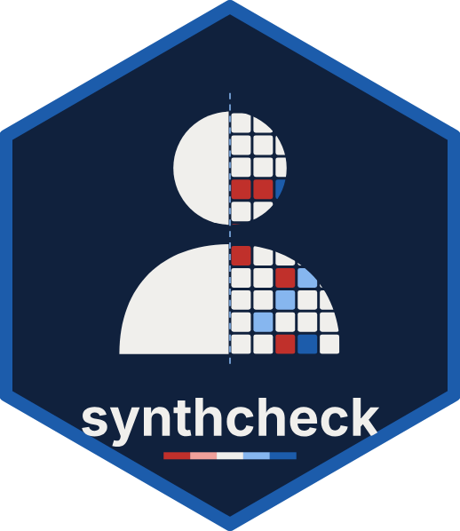

# synthcheck <a href="https://www.okanbulut.com/synthcheck/"></a>

<!-- badges: start -->
[](https://github.com/okanbulut/synthcheck/actions/workflows/R-CMD-check.yaml)
<!-- badges: end -->

**Experimental.** synthcheck checks how authentic synthetic survey
respondents are: Whether respondents generated by large language models
resemble the real people they are meant to stand in for.

It looks at three things:

- **Overlap:** Do synthetic respondents land where real people land?
- **Structure:** Do the items relate to each other as they do in real people?
- **Behaviour (coming next):** Do synthetic respondents answer the way people
  do, including variability, extreme and midpoint answers, acquiescence,
  consistency and person fit?

Each index will be anchored between a shuffled baseline (0) and a second
sample of real people (100). The **synthetic authenticity benchmark** compares
several models in one table, scored by their weakest column by default.

The package compares models and supports decisions about them. It does not
show that synthetic respondents can replace a field test.

## Installation

```r
# install.packages("remotes")
remotes::install_github("okanbulut/synthcheck")
```

## Example

```r
library(synthcheck)

# Honesty-Humility, Canada: real people and four language models
h <- hexaco_items$item[hexaco_items$trait == "H"]
rev_items <- intersect(h, hexaco_items$item[hexaco_items$reverse])
keyed <- function(d) { d <- d[h]; d[rev_items] <- 8 - d[rev_items]; d }

real <- keyed(hexaco_real[hexaco_real$country == "Canada", ])
ca <- hexaco_llm[hexaco_llm$country == "Canada" & hexaco_llm$attempt <= 4, ]
synthetic <- lapply(split(ca, ca$model, drop = TRUE),
                    function(m) lapply(split(m, m$attempt), keyed))

cov <- synthetic_coverage(synthetic, real, cor = "pearson")
cov
gg_coverage(cov)
```

## Data

`hexaco_real` holds 17,874 real respondents to the 240 IPIP-HEXACO items from
Canada, Great Britain and the United States (Open-Source Psychometrics
Project). `hexaco_llm` holds 59,611 synthetic respondents from four open-weight
language models (10 attempts per country), and `hexaco_items` holds the item
text, facets and keys.

## Related

synthcheck grew out of the coverage strip in
[mirtverse](https://www.okanbulut.com/mirtverse/). See the article
[Checking synthetic respondents: The coverage strip](https://www.okanbulut.com/mirtverse/articles/synthetic-coverage.html).
