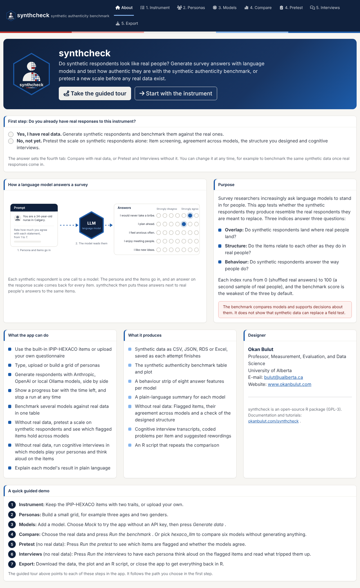
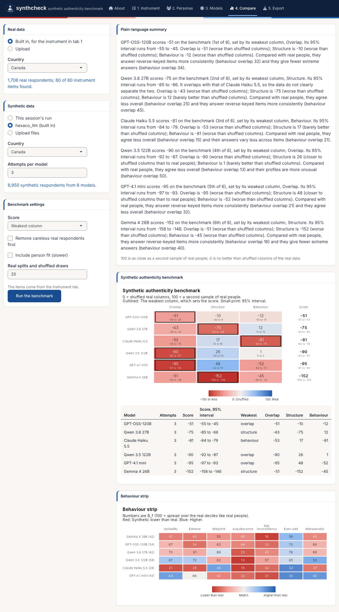

# A tour of the synthcheck app

[`run_synthcheck_app()`](https://www.okanbulut.com/synthcheck/reference/run_synthcheck_app.md)
opens an app that does the whole synthcheck workflow without code. It
starts with one question: **Do you already have real responses to this
instrument?** The answer chooses one of two paths through the same tabs.

- **With real data:** Define an instrument and personas, generate
  synthetic respondents with one or more language models, **benchmark**
  them against the real data in the Compare tab, and save everything.
- **Without real data:** Generate synthetic respondents the same way,
  **pretest** the scale on them in the Pretest tab, run **cognitive
  interviews** with language models in the Interviews tab, and save
  everything.

| Tab | With real data | Without real data |
|----|----|----|
| About | The first question and the guided tour | The first question and the guided tour |
| 1\. Instrument | The items and the response scale | The items and the response scale |
| 2\. Personas | Who the synthetic respondents are | Who the synthetic respondents are |
| 3\. Models | Generate the synthetic data | Generate the synthetic data, at several temperatures if you want |
| 4\. | **Compare:** The benchmark | **Pretest:** Item screening and the designed structure |
| 5\. | **Export:** Data, benchmark and R script | **Interviews:** Cognitive interviews with language models |
| 6\. |  | **Export:** Data, pretest, interviews and R script |

This article walks through every tab on both paths. For worked examples,
see [the app
demos](https://www.okanbulut.com/synthcheck/articles/app-demo.md).

The benchmark compares models and supports decisions about them. It does
not show that synthetic data can replace a field test. The pretest and
the interviews are screening aids: They point to items worth a second
look, and a field test with real people still decides.

## Starting the app

The app needs a few suggested packages:

``` r

install.packages(c("shiny", "bslib", "ellmer", "callr", "jsonlite"))
# optional: readxl and writexl for Excel files, cicerone for the guided tour
```

``` r

library(synthcheck)
res <- run_synthcheck_app()
```

The app runs on your own computer and opens in your browser. You can
pass real or synthetic data to it. Real data appear in the Compare tab
and start the app on the path with real data. Synthetic data appear in
the Compare and Pretest tabs:

``` r

res <- run_synthcheck_app(real = my_real_data, synthetic = my_earlier_run)
```

When you close the app with the button in the Export tab, `res` holds
the generated data, the benchmark, the pretest, the interviews, the path
you chose, the instrument and the personas.

## About



The About tab that opens the app.

The app opens on the **About** tab. It explains what the app is for,
lists what it can do and what it produces, and shows an animated picture
of a language model answering survey items: A persona and the items go
in, the model answers each item on the response scale, and synthcheck
compares the answers with real people. A short guided demo lists the
steps of both paths, and the designer’s contact details and a link to
this website are at the side.

### First step: Real data or not?


The first step on the About tab: Real data or not?

**Do you already have real responses to this instrument?** The answer
sets the fourth tab:

- **Yes, I have real data.** The fourth tab is **Compare**, the
  benchmark against real people.
- **No, not yet.** The fourth tab is **Pretest**, pilot screening of the
  scale on synthetic respondents alone, and the fifth is **Interviews**,
  cognitive interviews in which language models play your personas.
  Export moves to the sixth tab, and Compare is hidden.

Tabs 1 to 3 and Export are the same on both paths. You can change the
answer at any time: The data you generated stay in the session, so you
can pretest a scale now and benchmark the same synthetic data once real
responses come in.

### The guided tour

**Take the guided tour** walks through the app one control at a time and
switches the tabs for you. It follows the path you chose: With real
data, it ends with the benchmark; without real data, it shows the
pretest and the interviews. To see the other path, change the answer and
start the tour again. The tour needs the cicerone package
(`install.packages("cicerone")`).


The guided tour pointing to the items on the Instrument tab.

**Start with the instrument** skips the tour and opens the first tab.

## 1. Instrument


The Instrument tab with two HEXACO traits selected.

Choose the items on the left: The built-in IPIP-HEXACO items (pick the
traits; two traits give 80 items, all six give 240), or your own item
table. Set the lowest and highest category, the category labels and the
instructions.

The right side checks the instrument and shows the **prompt sent for
each respondent**, so you see exactly what a model will read.


Uploading an item table, with the template button.

To use your own questionnaire, choose **Upload an item table** and
download the template. It has the columns `item` (a short name),
`statement` (the text), and optionally `scale`, `facet` and `reverse`
(`TRUE` for reverse-keyed items). CSV and Excel both work. The same
template is in the package:

``` r

system.file("templates", "instrument_template.csv", package = "synthcheck")
```

Without real data, the `scale` and `reverse` columns matter more: They
are the structure you designed, and the Pretest tab checks whether it
comes back in the synthetic answers.

## 2. Personas


The Personas tab building a grid of personas.

A persona is who the synthetic respondent is told to be. There are four
ways to set them:

- **No persona:** Every respondent gets the same neutral prompt.
- **Type them:** One description per line.
- **Build a grid:** List a few attributes (`age: 25, 45, 65`) and a
  description with `{age}` in it. The app makes every combination.
- **Upload a table:** A `description` column, with optional `persona_id`
  and attribute columns. The attributes are kept in the generated data.
  The template is `personas_template.csv`.

On the path without real data, the same personas also take part in the
cognitive interviews.

## 3. Models


The Models tab with two models, the run plan and the time estimate.

**API keys.** Type an Anthropic or OpenAI key, or set
`ANTHROPIC_API_KEY` and `OPENAI_API_KEY` in `.Renviron`, and the app
uses them without showing them. Typed keys stay in memory for this
session only. They are never written to the saved data, the run settings
or the R script. Ollama models run on your own computer and need no key.

**Add a model.** Pick a provider and a model id (or type one), set the
temperature and an optional label, and click **Add model**. Add as many
as you want to compare. **Mock** gives random answers without an API,
which is useful for trying the app.

**Several temperatures.** Type a list such as `0.3, 0.7, 1.2` in **Or
several temperatures** to add the same model once per temperature.
Without real data, the Pretest tab then shows whether the flagged items
hold across the temperatures.

**Run.** Set the number of attempts (full passes over the personas) and
the respondents per persona per attempt. The plan under the settings
tells you how many respondents the run will make.

- **Calls at the same time** speeds up a run when the API allows it.
- **Respondents per call** above 1 is cheaper, but respondents in the
  same call may depend on each other. Keep 1 for independent
  respondents.
- **Items per call** splits a long instrument into blocks.
- **Estimate run time** sends one test call per model and tells you how
  long the whole run should take. It is also a quick check that the keys
  and model ids work.


A run in progress, with the time left for each model.

**Generate data** starts the run in a background R process, so the app
stays responsive. The progress bar shows the respondents done and the
time left, and **Stop** ends the run after the calls in progress. Every
attempt is saved to the output folder as soon as it is done, so a
stopped run keeps its finished attempts.

## 4. Compare (with real data)



The Compare tab after a benchmark.

Choose the real data (the built-in `hexaco_real` for one country, data
you passed to
[`run_synthcheck_app()`](https://www.okanbulut.com/synthcheck/reference/run_synthcheck_app.md),
or an upload) and the synthetic data (this session’s run, the built-in
`hexaco_llm`, or files saved by an earlier run). Then click **Run the
benchmark**.

The right side shows a plain-language summary per model, the synthetic
authenticity benchmark with its table, and the behaviour strip. In the
benchmark, tiles run from red (-100 or lower) through pale (0, no better
than shuffled real answers) to blue (100, as close as a second sample of
real people). In the behaviour strip, red means lower than real people,
blue means higher, and pale means a match.

**Benchmark settings:**

- **Score:** The weakest column (the default), the mean or the geometric
  mean of the three columns.
- **Remove careless real respondents first:** Compare with real
  respondents after careless ones are flagged and removed
  (`clean_real = TRUE`).
- **Include person fit:** Fits a graded response model per trait to the
  real data. It is slower; switch it off while you explore.
- **Real splits and shuffled draws:** How many draws set the 0 and 100
  anchors. More is steadier and slower.

The [benchmark
tutorial](https://www.okanbulut.com/synthcheck/articles/benchmark.md)
explains the anchors and the score.

## 4. Pretest (without real data)


The Pretest tab after a pretest of six models.

Without real data, the fourth tab runs
[`synthetic_pretest()`](https://www.okanbulut.com/synthcheck/reference/synthetic_pretest.md)
on the synthetic data: This session’s run, the built-in `hexaco_llm`,
data you passed to
[`run_synthcheck_app()`](https://www.okanbulut.com/synthcheck/reference/run_synthcheck_app.md),
or files saved by an earlier run.

**Pretest settings:**

- **Compare the flags across:** Models (each label in the Models tab),
  temperatures, personas, or nothing (pool all respondents). An item
  that is flagged under every condition is worth more attention than one
  flagged by a single model.
- **Include IRT slopes:** Fits a graded response model per scale. It is
  slower.
- **Random data sets for parallel analysis:** How many random data sets
  set the line that a dimension has to clear.

The items, scales and reverse keys come from the Instrument tab: They
are the structure the pretest checks. Click **Run the pretest**.

The tab shows a plain-language summary, the **flagged items** (items
that barely vary, link weakly to their scale, duplicate another item or
work against their reverse key) with the number of conditions that flag
each one, and **the scales and the structure you designed**: The
reliability of each scale, the dimensions parallel analysis finds and
whether the items and reverse keys follow the design. The [pretest
tutorial](https://www.okanbulut.com/synthcheck/articles/pretest.md)
explains each result. It is pilot screening, not validation: Language
models answer more tidily than people.

## 5. Interviews (without real data)


The Interviews tab after interviews on the flagged items.

The Interviews tab runs
[`cognitive_interview()`](https://www.okanbulut.com/synthcheck/reference/cognitive_interview.md).
A language model plays each persona from the Personas tab, thinks aloud
while it answers an item and answers a set of verbal probes. A separate
call then codes each transcript for comprehension, retrieval, judgement,
response-mapping and sensitivity problems.

**Items.** Interview the **items flagged by the pretest**, or choose
**items I choose** from the instrument. The pretest is optional. When it
has run, each flagged item gets one more probe aimed at the reason for
the flag.

**Interview settings.** The personas come from the Personas tab and the
models from the Models tab.

- **Who codes the transcripts:** Each model codes its own interviews, or
  one of the other models codes them all, so that no model grades its
  own work.
- **Interviews per persona and item** and **Interviews at the same
  time** set the size and the speed of the run. The plan under the
  settings counts the interviews and the requests (three per interview:
  Think-aloud, probes and coding).
- **Probes:** One per line, as `stage: probe`. Edit them, add your own
  or remove the ones you do not need.

Click **Run the interviews**. A progress bar counts the interviews, and
**Stop** ends the run.

The right side shows a plain-language summary, the **problems per item**
(one row per item, one column per kind of problem, from pale to red as
more interviews run into it) with a table of the share of interviews
with a problem, the most common kind and a suggested rewording, and the
**transcripts**: Pick an item to read each persona’s think-aloud, answer
and probe answers, with the coding. The [cognitive interviews
tutorial](https://www.okanbulut.com/synthcheck/articles/cognitive-interviews.md)
explains the probes and the coding. It is a screening aid, not a
substitute for cognitive interviews with real people.

## Export


The Export tab with downloads and the R script.

Download the synthetic data in CSV, JSON, RDS or Excel. The other
downloads follow the path:

- **With real data:** The benchmark table, the summary and the benchmark
  plot.
- **Without real data:** The pretest items, the pretest summary and the
  pretest plot, and the interviews (CSV), the transcripts (Markdown) and
  the interview plot.

**Repeat it in R** gives a script that reads the saved data and runs the
same benchmark, or the same pretest and interviews, so the analysis can
be checked and rerun without the app. **Close the app and return to R**
hands everything back to the R session.
