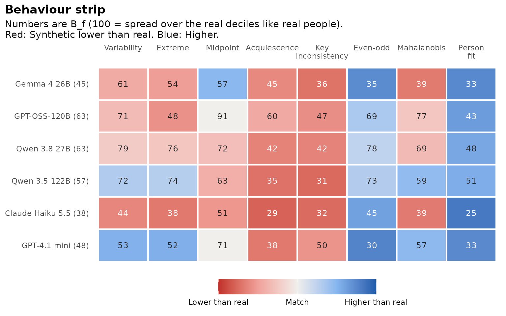
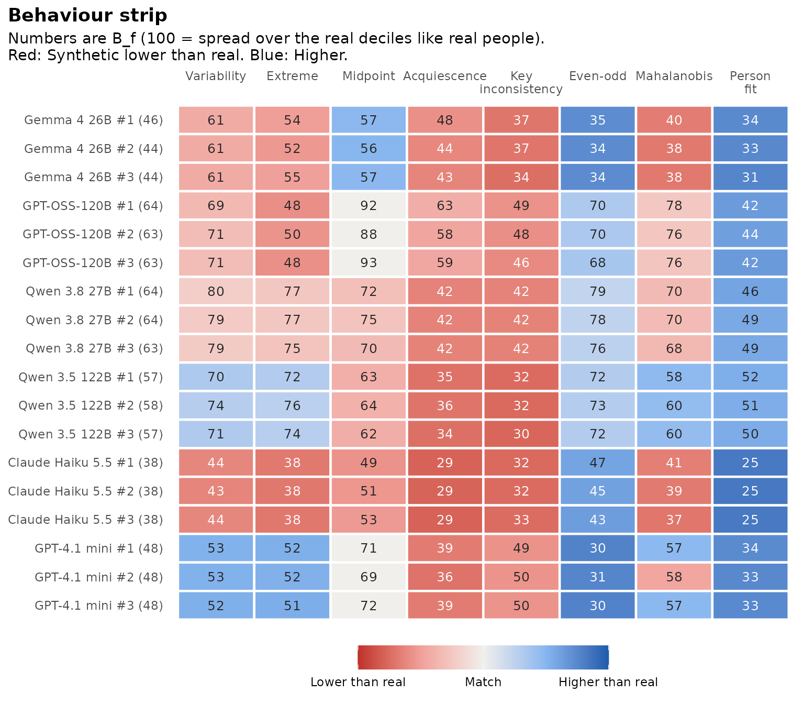

# Behaviour: How synthetic respondents answer

**Experimental.** Two sets of answers can land in the same score deciles
and still be given in very different ways. Behaviour compares how
synthetic and real respondents answer, with eight features per
respondent. This tutorial covers
[`behaviour_features()`](https://www.okanbulut.com/synthcheck/reference/behaviour_features.md),
[`flag_careless()`](https://www.okanbulut.com/synthcheck/reference/flag_careless.md),
[`synthetic_behaviour()`](https://www.okanbulut.com/synthcheck/reference/synthetic_behaviour.md)
and
[`gg_behaviour()`](https://www.okanbulut.com/synthcheck/reference/gg_behaviour.md).

These functions take the raw answers and an item table, and do the
keying themselves.

``` r

library(synthcheck)

h <- hexaco_items[hexaco_items$trait == "H", ]
real <- hexaco_real[hexaco_real$country == "Canada", ]
ca <- hexaco_llm[hexaco_llm$country == "Canada" & hexaco_llm$attempt <= 3, ]
```

## The eight features

| Feature | What it measures | Careless side |
|----|----|----|
| `variability` | SD of the raw answers | Very low or very high |
| `extreme` | Share of answers at the lowest or highest category | High |
| `midpoint` | Share of answers at the middle category | High |
| `acquiescence` | Mean raw answer minus the scale midpoint | High |
| `key_inconsistency` | Gap between positive and reverse-keyed items of a facet | High |
| `even_odd` | Agreement of odd and even items across facets | Low |
| `mahalanobis` | Distance of the facet means from real people | High |
| `person_fit` | $`l_z`$ under a graded response model fitted to the real data | Low; very high means “too coherent” |

[`behaviour_features()`](https://www.okanbulut.com/synthcheck/reference/behaviour_features.md)
gives the eight values for every respondent. The reference for
Mahalanobis distance and person fit comes from the real data:

``` r

syn1 <- ca[ca$attempt == 1, ]
f_syn <- behaviour_features(syn1, h, real = real)
f_real <- behaviour_features(real, h)

rbind(real = sapply(f_real, median, na.rm = TRUE),
      synthetic = sapply(f_syn, median, na.rm = TRUE))
#>           variability extreme midpoint acquiescence key_inconsistency  even_odd
#> real         1.853185    0.20    0.100       -0.075         1.0409722 0.6569726
#> synthetic    1.781493    0.15    0.075       -0.550         0.5256944 0.9226334
#>           mahalanobis person_fit
#> real         1.799893  0.4623339
#> synthetic    1.718303  1.5634440
```

Person fit fits one graded response model per scale with mirt, on the
real data only. It is the slowest feature. `fit_scales = character(0)`
skips it, which is handy while you explore.

## Careless real respondents

Real data have careless respondents too.
[`flag_careless()`](https://www.okanbulut.com/synthcheck/reference/flag_careless.md)
flags a real respondent when at least two of the eight features fall in
the most extreme 2.5% on the careless side:

``` r

fl <- flag_careless(real, h)
mean(fl$careless)
#> [1] 0.04274005
table(fl$n_flags)
#> 
#>    0    1    2    3    4 
#> 1465  170   57    8    8
```

By default synthcheck compares synthetic respondents with all real
respondents, because that is the data people can actually collect.
`clean_real = TRUE` in
[`synthetic_behaviour()`](https://www.okanbulut.com/synthcheck/reference/synthetic_behaviour.md)
and
[`authenticity_benchmark()`](https://www.okanbulut.com/synthcheck/reference/authenticity_benchmark.md)
compares them with the real respondents left after the flagged ones are
removed. `careless_rule` takes your own rule: A function of the feature
table that returns `TRUE` for careless respondents.

``` r

strict <- function(f) f$variability < 0.5 | f$person_fit < -3
flag_careless(real, h, rule = strict)
```

## The Behaviour index

[`synthetic_behaviour()`](https://www.okanbulut.com/synthcheck/reference/synthetic_behaviour.md)
cuts the real values of each feature at their deciles and counts the
share of synthetic respondents in each decile, as Overlap does for score
deciles. A feature scores 100 when synthetic respondents spread over the
real deciles like real people, and 10 when they all fall in one decile.
Behaviour is the mean over the eight features.

``` r

beh <- synthetic_behaviour(as_synthetic_list(ca), real, h)
beh
#> Behaviour of synthetic respondents (experimental)
#> 40 items, 1708 real respondents; person fit on H.
#> 
#>             model attempts Behaviour Lowest Highest lz < P5 (%) lz > P95 (%)
#>       Gemma 4 26B        3      44.8   44.3    45.8           0          1.5
#>      GPT-OSS-120B        3      63.2   62.8    63.9           0          3.1
#>      Qwen 3.8 27B        3      63.5   62.8    64.0           0          0.1
#>     Qwen 3.5 122B        3      57.3   56.9    58.1           0          0.0
#>  Claude Haiku 5.5        3      37.8   37.6    38.1           0          0.0
#>      GPT-4.1 mini        3      48.0   47.8    48.3           0          3.5
#> 
#> Behaviour is 100 when synthetic respondents spread over the real deciles of every feature.
```

``` r

gg_behaviour(beh)
```



Each cell is one feature for one model. The number is $`B_f`$, red means
the synthetic median is lower than the real one, blue means higher, and
the shade shows how far the feature is from real people. Here the common
pattern is “too tidy”: Key inconsistency and acquiescence are lower than
in real people (red), while even-odd consistency and person fit are
higher (blue). Synthetic respondents answer more consistently than real
people do.

`by = "attempt"` draws one row per attempt to show how stable each model
is:

``` r

gg_behaviour(beh, by = "attempt")
```



The summary also gives the person fit tails: The share of synthetic
respondents below the real 5th percentile of $`l_z`$ (careless-like) and
above the real 95th percentile (too coherent). Real data have 5% in
each.

``` r

beh$summary[, c("model", "lz_low", "lz_high")]
#> # A tibble: 6 × 3
#>   model            lz_low lz_high
#>   <chr>             <dbl>   <dbl>
#> 1 Gemma 4 26B           0 0.0153 
#> 2 GPT-OSS-120B          0 0.0307 
#> 3 Qwen 3.8 27B          0 0.00133
#> 4 Qwen 3.5 122B         0 0      
#> 5 Claude Haiku 5.5      0 0      
#> 6 GPT-4.1 mini          0 0.0353
```

No model has careless-like respondents. The medians of person fit are
higher than in real people, but few synthetic respondents pass the real
95th percentile: They fit the model a little better than typical real
people, not better than the most coherent ones.

## Next

[The
benchmark](https://www.okanbulut.com/synthcheck/articles/benchmark.md)
puts Behaviour together with Overlap and Structure.
