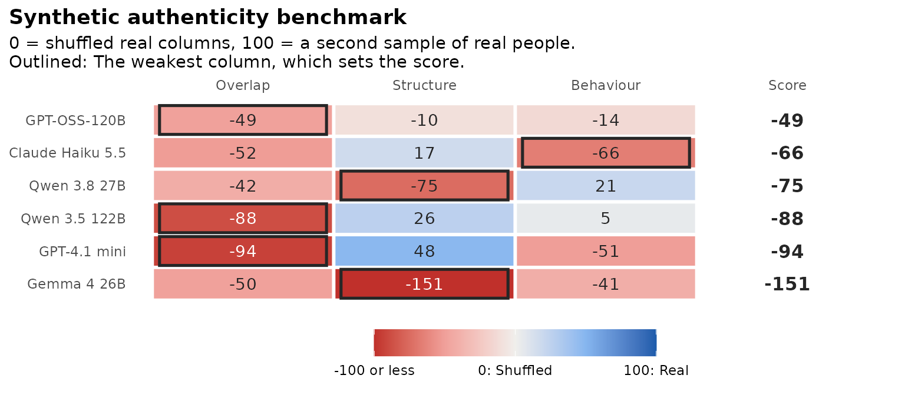
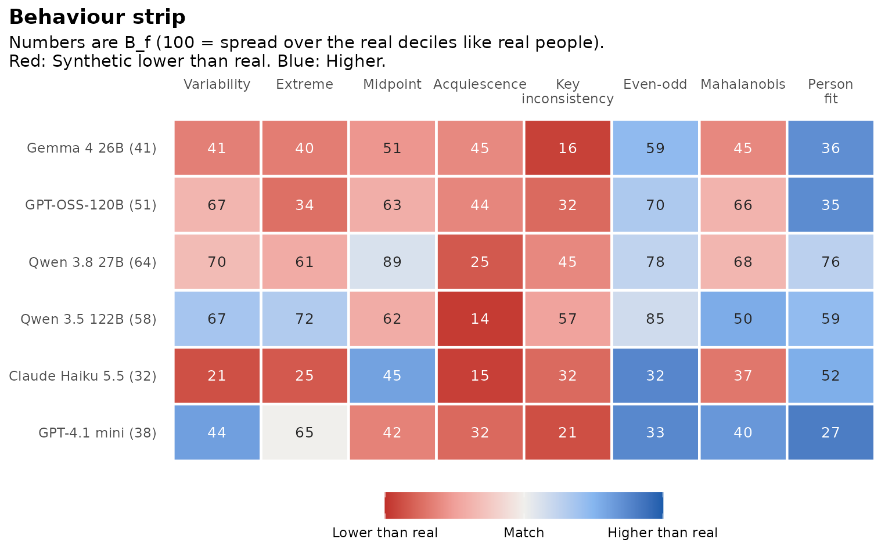

# The synthetic authenticity benchmark

**Experimental.**
[`authenticity_benchmark()`](https://www.okanbulut.com/synthcheck/reference/authenticity_benchmark.md)
compares several language models on Overlap, Structure and Behaviour,
and puts them in one table with a single score per model. The benchmark
compares models and supports decisions about them. It does not show that
synthetic data can replace a field test.

## A first benchmark

Like the Behaviour functions,
[`authenticity_benchmark()`](https://www.okanbulut.com/synthcheck/reference/authenticity_benchmark.md)
takes raw answers and an item table and does the keying itself. Here are
two traits, Honesty-Humility and Conscientiousness (80 items), for
Canada, with three attempts per model:

``` r

library(synthcheck)

items <- hexaco_items[hexaco_items$trait %in% c("H", "C"), ]
real <- hexaco_real[hexaco_real$country == "Canada", ]
ca <- hexaco_llm[hexaco_llm$country == "Canada" & hexaco_llm$attempt <= 3, ]
synthetic <- as_synthetic_list(ca, items = items$item)
```

``` r

bm <- authenticity_benchmark(synthetic, real, items, n_splits = 10, n_floor = 10)
bm
#> Synthetic authenticity benchmark (experimental)
#> 80 items, 1708 real respondents. Score: weakest.
#> 
#>             model attempts Overlap Structure Behaviour Score   Weakest
#>      GPT-OSS-120B        3     -49       -10       -14   -49   Overlap
#>  Claude Haiku 5.5        3     -52        17       -66   -66 Behaviour
#>      Qwen 3.8 27B        3     -42       -75        21   -75 Structure
#>     Qwen 3.5 122B        3     -88        26         5   -88   Overlap
#>      GPT-4.1 mini        3     -94        48       -51   -94   Overlap
#>       Gemma 4 26B        3     -50      -151       -41  -151 Structure
#> 
#> Anchors (raw, floor to ceiling, samples of 500): Overlap 52.3 to 92.5, Structure 84.2 to 94.6, Behaviour 56.5 to 92.8.
#> 0 = shuffled real columns, 100 = a second sample of real people.
```

``` r

gg_benchmark(bm)
```



## Reading the anchored values

Every column is rescaled between two anchors:

- **Floor (0):** A dumb generator that draws each item column on its own
  from the real data. It keeps every item’s distribution but breaks
  people apart.
- **Ceiling (100):** A second, separate sample of real people, scored
  against the first with the same index.

So 100 means “as close to real people as other real people are”, and 0
means “no better than shuffled columns”. Values below 0 mean the model
is further from real people than shuffled real answers: Its respondents
bunch into fewer score deciles (Overlap), its items correlate more than
real ones (Structure), or its answers are tidier than real people’s
(Behaviour). Tables show the values as they are, and
[`gg_benchmark()`](https://www.okanbulut.com/synthcheck/reference/gg_benchmark.md)
colours them from red (-100 or lower) through pale (0) to blue (100).

``` r

bm$anchors
#> # A tibble: 3 × 5
#>   index     floor ceiling floor_sd ceiling_sd
#>   <chr>     <dbl>   <dbl>    <dbl>      <dbl>
#> 1 overlap    52.3    92.5   0.939       0.921
#> 2 structure  84.2    94.6   0.0818      0.215
#> 3 behaviour  56.5    92.8   0.679       0.631
```

`n_floor` and `n_splits` set how many shuffled draws and real splits are
averaged (20 by default). With `ceiling_n = "attempt"` (the default),
the ceiling samples are the size of a typical synthetic attempt, so the
sampling noise is comparable. `ceiling_n = "half"` uses the two halves
of the real data.

## Choosing the score

The default score is the **weakest** column, named in `weakest`: A model
is only as authentic as its weakest side. You can change it:

``` r

bm_mean <- authenticity_benchmark(synthetic, real, items, score = "mean",
                                  weights = c(overlap = 1, structure = 1, behaviour = 2),
                                  n_splits = 10, n_floor = 10)
bm_mean$table[, c("model", "score", "overlap", "structure", "behaviour")]
#> # A tibble: 6 × 5
#>   model            score overlap structure behaviour
#>   <chr>            <dbl>   <dbl>     <dbl>     <dbl>
#> 1 Qwen 3.5 122B    -13.1   -88.2     26.5       4.64
#> 2 Qwen 3.8 27B     -18.8   -41.7    -74.6      20.5 
#> 3 GPT-OSS-120B     -22.0   -49.5     -9.79    -14.3 
#> 4 GPT-4.1 mini     -36.8   -93.5     47.8     -50.8 
#> 5 Claude Haiku 5.5 -41.8   -51.6     17.2     -66.3 
#> 6 Gemma 4 26B      -70.8   -49.7   -151.      -41.4
```

`score = "geometric"` takes the geometric mean of the clamped values,
and a function of `overlap`, `structure` and `behaviour` gives your own
score.

## The plain-language summary

``` r

summarise_benchmark(bm)
#> Synthetic authenticity benchmark in plain language (experimental)
#> 
#> GPT-OSS-120B scores -49 on the benchmark (1st of 6), set by its weakest
#> column, Overlap. Overlap is -49 (worse than shuffled columns);
#> Structure is -10 (worse than shuffled columns); Behaviour is -14 (worse
#> than shuffled columns). Compared with real people, they answer
#> reverse-keyed items more consistently (behaviour overlap 32) and they
#> give fewer extreme answers (behaviour overlap 34).
#> 
#> Claude Haiku 5.5 scores -66 on the benchmark (2nd of 6), set by its
#> weakest column, Behaviour. Overlap is -52 (worse than shuffled
#> columns); Structure is 17 (barely better than shuffled columns);
#> Behaviour is -66 (worse than shuffled columns). Compared with real
#> people, they agree less overall (behaviour overlap 15) and their
#> answers vary less across items (behaviour overlap 21).
#> 
#> Qwen 3.8 27B scores -75 on the benchmark (3rd of 6), set by its weakest
#> column, Structure. Overlap is -42 (worse than shuffled columns);
#> Structure is -75 (worse than shuffled columns); Behaviour is 21 (barely
#> better than shuffled columns). Compared with real people, they agree
#> less overall (behaviour overlap 25) and they answer reverse-keyed items
#> more consistently (behaviour overlap 45).
#> 
#> Qwen 3.5 122B scores -88 on the benchmark (4th of 6), set by its
#> weakest column, Overlap. Overlap is -88 (worse than shuffled columns);
#> Structure is 26 (closer to shuffled columns than to real people);
#> Behaviour is 5 (barely better than shuffled columns). Compared with
#> real people, they agree less overall (behaviour overlap 14) and their
#> profiles are more unusual (behaviour overlap 50).
#> 
#> GPT-4.1 mini scores -94 on the benchmark (5th of 6), set by its weakest
#> column, Overlap. Overlap is -94 (worse than shuffled columns);
#> Structure is 48 (closer to shuffled columns than to real people);
#> Behaviour is -51 (worse than shuffled columns). Compared with real
#> people, they answer reverse-keyed items more consistently (behaviour
#> overlap 21) and they fit the response model better (behaviour overlap
#> 27). 20% of its respondents fit the response model better than 95% of
#> real people, so they look too coherent.
#> 
#> Gemma 4 26B scores -151 on the benchmark (6th of 6), set by its weakest
#> column, Structure. Overlap is -50 (worse than shuffled columns);
#> Structure is -151 (worse than shuffled columns); Behaviour is -41
#> (worse than shuffled columns). Compared with real people, they answer
#> reverse-keyed items more consistently (behaviour overlap 16) and they
#> fit the response model better (behaviour overlap 36).
#> 
#> 100 = as close as a second sample of real people; 0 = no better than shuffled columns.
```

The text follows fixed rules and states only values in the table, so the
same benchmark always gives the same summary.

## The pieces behind the table

``` r

names(bm)
#> [1] "table"     "attempts"  "anchors"   "behaviour" "careless"  "settings"
bm$attempts
#> # A tibble: 18 × 11
#>    model    attempt     n overlap_raw structure_raw behaviour_raw lz_low lz_high
#>    <chr>      <int> <int>       <dbl>         <dbl>         <dbl>  <dbl>   <dbl>
#>  1 Gemma 4…       1   500        33.3          69.1          41.6  0     0.048  
#>  2 Gemma 4…       2   500        33.1          68.8          42.5  0     0.056  
#>  3 Gemma 4…       3   500        30.5          67.9          40.3  0     0.028  
#>  4 GPT-OSS…       1   500        34.6          80.2          52.1  0     0.06   
#>  5 GPT-OSS…       2   500        31.7          84.3          51    0     0.066  
#>  6 GPT-OSS…       3   500        30.8          85.3          50.8  0     0.032  
#>  7 Qwen 3.…       1   450        36.0          76.6          63.6  0     0.00222
#>  8 Qwen 3.…       2   500        35.4          77.5          64.0  0     0.01   
#>  9 Qwen 3.…       3   500        35.1          75.4          64.2  0.002 0.012  
#> 10 Qwen 3.…       1   500        17.0          81.6          57.8  0     0      
#> 11 Qwen 3.…       2   500        17.0          89.8          58.4  0     0      
#> 12 Qwen 3.…       3   500        16.4          89.5          58.3  0     0      
#> 13 Claude …       1   500        31.2          86.0          32.8  0     0      
#> 14 Claude …       2   500        31.8          85.8          32.3  0     0      
#> 15 Claude …       3   500        31.7          86.3          32.1  0     0      
#> 16 GPT-4.1…       1   500        14.8          88.8          37.9  0     0.204  
#> 17 GPT-4.1…       2   500        14.6          89.2          38.1  0     0.186  
#> 18 GPT-4.1…       3   500        14.6          89.6          38.1  0     0.196  
#> # ℹ 3 more variables: overlap <dbl>, structure <dbl>, behaviour <dbl>
```

`bm$behaviour` is the full
[`synthetic_behaviour()`](https://www.okanbulut.com/synthcheck/reference/synthetic_behaviour.md)
result, so the behaviour strip comes for free:

``` r

gg_behaviour(bm$behaviour)
```



## Settings that change the target

- `clean_real = TRUE`: Compare against real respondents after careless
  ones are removed (see
  [Behaviour](https://www.okanbulut.com/synthcheck/articles/behaviour.md)).
  The flags are in `bm$careless`.
- `fit_scales`: The scales used for person fit. `character(0)` skips
  person fit, which makes the benchmark much faster while you explore.
- `cor = "polychoric"`: Polychoric correlations for Structure (needs
  polycor, slow on many items).

## All 240 items

The full benchmark, with person fit on all six traits, takes several
minutes:

``` r

real <- hexaco_real[hexaco_real$country == "Canada", ]
ca <- hexaco_llm[hexaco_llm$country == "Canada", ]
bm_all <- authenticity_benchmark(as_synthetic_list(ca), real, hexaco_items)
gg_benchmark(bm_all)
```

## Next

[Diagnostics beside the
benchmark](https://www.okanbulut.com/synthcheck/articles/diagnostics.md)
checks construct structure and respondent coverage, and adds a copula
reference row. [Generating synthetic
respondents](https://www.okanbulut.com/synthcheck/articles/generate.md)
shows how to make your own synthetic data to benchmark.
