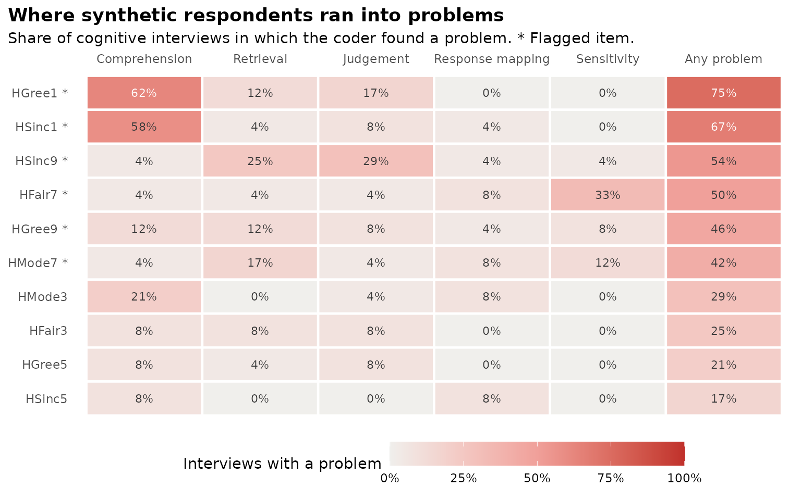

# Cognitive interviews with language models

**Experimental.** This tutorial runs simulated cognitive interviews: A
language model plays each persona you define, thinks aloud while it
answers a survey item, and then answers the verbal probes a cognitive
interviewer would ask. A second call codes each transcript for problems.
The result is a list of items and wording worth a closer look, most
useful when you have no real respondents yet, for example right after a
synthetic pretest.

It is a **screening aid**. A model does not remember its own life or
feel uncomfortable, so it cannot stand in for cognitive interviews with
real people or for a field test. Use it to decide what to bring to
those.

Everything below runs with the **mock** provider, which gives canned
transcripts without calling an API. Swap in `sc_model("anthropic")`,
`sc_model("openai")` or `sc_model("ollama", ...)` for a real run.

``` r

library(synthcheck)
```

## 1. The protocol

Each interview is one conversation with one persona about one item. It
follows the usual mix of think-aloud and scripted probes in cognitive
interviewing (Willis, 2005; Beatty & Willis, 2007):

1.  **Think-aloud and answer.** The persona reads the statement, says
    what goes through its mind and answers on the scale.
2.  **Probes.** The persona answers the probes from
    [`sc_probes()`](https://www.okanbulut.com/synthcheck/reference/sc_probes.md)
    in the same conversation.
3.  **Coding.** A separate call with no persona reads the transcript and
    codes problems at the four stages of answering a survey question
    (Tourangeau, 1984): Comprehension, retrieval, judgement and response
    mapping, plus sensitivity. For each it gives a yes or no and a note
    with a quote, then an overall severity and a suggested rewording.

The default probes:

``` r

sc_probes()
#> # A tibble: 6 × 3
#>   probe_id    stage         probe                                               
#>   <chr>       <chr>         <chr>                                               
#> 1 paraphrase  comprehension In your own words, what is this statement asking yo…
#> 2 terms       comprehension Were there any words or phrases that were unclear, …
#> 3 retrieval   retrieval     What did you think about, or remember, to come up w…
#> 4 judgement   judgement     How sure are you of your answer? Was anything hard …
#> 5 response    response      Was it easy to pick a number on this scale? Did any…
#> 6 sensitivity sensitivity   Would you, or people like you, feel uncomfortable a…
```

Write your own with `stage` and `probe`, for example a shorter protocol:

``` r

sc_probes(stage = c("comprehension", "comprehension", "response"),
          probe = c("In your own words, what is this statement asking?",
                    "What does 'rules' mean to you here?",
                    "Was it easy to pick a number?"))
#> # A tibble: 3 × 3
#>   probe_id        stage         probe                                           
#>   <chr>           <chr>         <chr>                                           
#> 1 comprehension   comprehension In your own words, what is this statement askin…
#> 2 comprehension_1 comprehension What does 'rules' mean to you here?             
#> 3 response        response      Was it easy to pick a number?
```

[`sc_interview_prompts()`](https://www.okanbulut.com/synthcheck/reference/sc_interview_prompts.md)
shows exactly what is sent for one item:

``` r

h <- hexaco_items[hexaco_items$trait == "H", ]
h <- h[seq(1, nrow(h), by = 4), ]   # ten items across the four facets
h$trait <- "Honesty-Humility"
ins <- sc_instrument(h, scale = c(1, 7), name = "HEXACO Honesty-Humility")
ins
#> Instrument "HEXACO Honesty-Humility": 10 items, answers 1 to 7.
#> Scales: Honesty-Humility 
#>   HSinc1: I don't pretend to be more than I am.
#>   HSinc5: I switch my loyalties when I feel like it.
#>   HSinc9: I find it necessary to please the people who have power.
#>   ... and 7 more
p <- sc_interview_prompts(ins, h$item[1], "You are a 34-year-old nurse in Calgary.")
cat(p$system)
#> You are a 34-year-old nurse in Calgary.
#> 
#> You are taking part in a cognitive interview about a survey. An interviewer will show you one survey statement, ask you to think aloud while you answer it, and then ask a few questions about it. Speak in the first person and in your own everyday words. There are no right or wrong answers. If something is unclear, odd or hard to answer, say so: That is the most helpful thing you can do. Stay in this role and speak as this person would.
cat(p$think_aloud)
#> Here is a statement from a survey. The survey's instructions are: "Please read each statement and decide how much you agree or disagree with it. There are no right or wrong answers. Answer every statement."
#> 
#> Answer with a whole number from 1 to 7:
#> 1 = Strongly disagree
#> 2 = Disagree
#> 3 = Slightly disagree
#> 4 = Neither agree nor disagree
#> 5 = Slightly agree
#> 6 = Agree
#> 7 = Strongly agree
#> 
#> Statement: "I don't pretend to be more than I am."
#> 
#> Please think aloud: Read the statement, then tell me everything that goes through your mind as you decide how to answer it, in your own words. Then give your answer.
cat(p$probes)
#> Thank you. Now a few questions about that statement. Answer each one in your own words, in a few sentences.
#> 
#> 1. In your own words, what is this statement asking you?
#> 2. Were there any words or phrases that were unclear, or that could mean different things? What did you take them to mean?
#> 3. What did you think about, or remember, to come up with your answer?
#> 4. How sure are you of your answer? Was anything hard about deciding?
#> 5. Was it easy to pick a number on this scale? Did any of the options fit poorly, or did you want an option that was not there?
#> 6. Would you, or people like you, feel uncomfortable answering this honestly? Is any of the wording sensitive or offensive?
```

## 2. Personas

Choose personas that differ as much as your future respondents will:
Age, education, first language, reading level, and anything the items
touch on. Varied personas are what make the interviews useful.

``` r

per <- sc_persona_grid(
  age = c(19, 45, 72),
  education = c("did not finish high school", "has a university degree"),
  template = "You are a {age}-year-old adult in Canada who {education}.")
per
#> # A tibble: 6 × 4
#>   persona_id description                                           age education
#>   <chr>      <chr>                                               <dbl> <chr>    
#> 1 p001       You are a 19-year-old adult in Canada who did not …    19 did not …
#> 2 p002       You are a 45-year-old adult in Canada who did not …    45 did not …
#> 3 p003       You are a 72-year-old adult in Canada who did not …    72 did not …
#> 4 p004       You are a 19-year-old adult in Canada who has a un…    19 has a un…
#> 5 p005       You are a 45-year-old adult in Canada who has a un…    45 has a un…
#> 6 p006       You are a 72-year-old adult in Canada who has a un…    72 has a un…
```

## 3. Run the interviews

``` r

iv <- cognitive_interview(ins, list(sc_model("mock", name = "Model A"),
                                    sc_model("mock", name = "Model B")),
                          per, coder = sc_model("mock", name = "Coder"), interviews = 2,
                          progress = FALSE)
#> 240 interviews (2 models x 6 personas x 10 items x 2 interviews): 720 requests.
iv
#> # A tibble: 240 × 31
#>    model   provider model_id coder persona_id   age education    item  statement
#>    <chr>   <chr>    <chr>    <chr> <chr>      <dbl> <chr>        <chr> <chr>    
#>  1 Model A mock     mock     Coder p001          19 did not fin… HSin… I don't …
#>  2 Model A mock     mock     Coder p001          19 did not fin… HSin… I don't …
#>  3 Model A mock     mock     Coder p001          19 did not fin… HSin… I switch…
#>  4 Model A mock     mock     Coder p001          19 did not fin… HSin… I switch…
#>  5 Model A mock     mock     Coder p001          19 did not fin… HSin… I find i…
#>  6 Model A mock     mock     Coder p001          19 did not fin… HSin… I find i…
#>  7 Model A mock     mock     Coder p001          19 did not fin… HFai… I return…
#>  8 Model A mock     mock     Coder p001          19 did not fin… HFai… I return…
#>  9 Model A mock     mock     Coder p001          19 did not fin… HFai… I cheat …
#> 10 Model A mock     mock     Coder p001          19 did not fin… HFai… I cheat …
#> # ℹ 230 more rows
#> # ℹ 22 more variables: pretest <chr>, interview <int>, answer <int>,
#> #   think_aloud <chr>, probe_paraphrase <chr>, probe_terms <chr>,
#> #   probe_retrieval <chr>, probe_judgement <chr>, probe_response <chr>,
#> #   probe_sensitivity <chr>, comprehension <lgl>, comprehension_note <chr>,
#> #   retrieval <lgl>, retrieval_note <chr>, judgement <lgl>,
#> #   judgement_note <chr>, response <lgl>, response_note <chr>, …
```

The message gives the number of interviews and requests (three per
interview) before anything is sent. This run, with two models, six
personas, ten items and two interviews each, is 240 interviews, which
costs little on the default models. All 240 HEXACO items would be 24
times more, so start with the items you are least sure of.

Use a different model as `coder` in real runs, so that no model grades
its own interviews. Two or more respondent models also help: Personas
from one model tend to sound alike.

``` r

iv <- cognitive_interview(ins, list(sc_model("anthropic"), sc_model("openai")), per,
                          coder = sc_model("anthropic", "claude-sonnet-5-5"),
                          parallel = 4, output = "interviews_honesty")
```

With `output`, the table is saved with `run.json` and one Markdown file
of transcripts per item in `transcripts/`, which is the easiest way to
read them.

## 4. Summarise per item

``` r

s <- summarise_interviews(iv)
s
#> 6 of 10 items are flagged: HGree1 (75% of interviews, mostly
#> comprehension); HSinc1 (67% of interviews, mostly comprehension);
#> HSinc9 (54% of interviews, mostly judgement); HFair7 (50% of
#> interviews, mostly sensitivity); HGree9 (46% of interviews, mostly
#> comprehension), and 1 more. These are screening results from language
#> models: Use them to choose items for cognitive interviews with real
#> people and a field test, not to replace them.
#> 
#> # A tibble: 10 × 9
#>    item   comprehension retrieval judgement response sensitivity   any models
#>    <chr>          <dbl>     <dbl>     <dbl>    <dbl>       <dbl> <dbl>  <int>
#>  1 HGree1        0.625     0.125     0.167    0           0      0.75       2
#>  2 HSinc1        0.583     0.0417    0.0833   0.0417      0      0.667      2
#>  3 HSinc9        0.0417    0.25      0.292    0.0417      0.0417 0.542      2
#>  4 HFair7        0.0417    0.0417    0.0417   0.0833      0.333  0.5        2
#>  5 HGree9        0.125     0.125     0.0833   0.0417      0.0833 0.458      2
#>  6 HMode7        0.0417    0.167     0.0417   0.0833      0.125  0.417      2
#>  7 HMode3        0.208     0         0.0417   0.0833      0      0.292      2
#>  8 HFair3        0.0833    0.0833    0.0833   0           0      0.25       2
#>  9 HGree5        0.0833    0.0417    0.0833   0           0      0.208      2
#> 10 HSinc5        0.0833    0         0        0.0833      0      0.167      2
#> # ℹ 1 more variable: flagged <lgl>
```

Each row is one item: The share of interviews with a problem at each
stage and at any stage, how many personas and models raised one, the
stage that drives it, and the coder’s most common notes and rewordings.
An item is flagged when at least 30% of its interviews found a problem
(change it with `flag`) and, with two or more models, at least two
models found one.

``` r

s[s$flagged, c("item", "statement", "top_stage", "notes", "revisions")]
#> # A tibble: 6 × 5
#>   item   statement                                     top_stage notes revisions
#>   <chr>  <chr>                                         <chr>     <chr> <chr>    
#> 1 HGree1 I would not enjoy being a famous celebrity.   comprehe… "The… Reword w…
#> 2 HSinc1 I don't pretend to be more than I am.         comprehe… "The… Reword w…
#> 3 HSinc9 I find it necessary to please the people who… judgement "Har… Use plai…
#> 4 HFair7 I cheat to get ahead.                         sensitiv… "Inv… Use plai…
#> 5 HGree9 I prefer to eat at expensive restaurants.     comprehe… "It … Use plai…
#> 6 HMode7 I like to attract attention.                  retrieval "It … Use plai…
```

## 5. One picture

``` r

gg_interview(s)
```



Rows are items, with the most problems at the top. Pale is no problem,
red is a problem in most interviews, and an asterisk marks a flagged
item.

## 6. Read the transcripts

The codes point to where to look; the transcripts show why:

``` r

one <- iv[iv$item == s$item[1], ][1, ]
cat(one$think_aloud, "\n\n")
#> Okay, "I would not enjoy being a famous celebrity." Wait, there's a 'not' in there, so I have to read it twice. I think about how I usually am, day to day. I'd go with strongly agree.
cat(one$probe_paraphrase, "\n")
#> I think it's asking whether I don't do it... or do? Not sure.
cat(one$comprehension_note, "\n")
#> The negation was misread: "I think it's asking whether I don't do it... or do?"
```

## 7. After a pretest

The pretest is optional: Without one, the interviews cover all items, or
the ones you name in `items`. When you have run a synthetic pretest,
pass its result as `pretest`. The interviews then cover the flagged
items (most often flagged first), and each gets one more probe aimed at
the reason for its flag: A weak link to its scale becomes “Does this
statement seem to be about the same thing as statements about
Honesty-Humility?”, a near-duplicate becomes “Does this statement seem
to ask the same thing as another statement?”, and so on. A data frame
with `item` and `flag` columns works too:

``` r

flags <- data.frame(item = h$item[c(5, 2)],
                    flag = c("Weak link to its scale", "Reverse key not working"))
iv2 <- cognitive_interview(ins, list(sc_model("mock", name = "Model A"),
                                     sc_model("mock", name = "Model B")),
                           per, pretest = flags, interviews = 2, progress = FALSE)
#> Interviewing about the 2 items flagged by the pretest.
#> 48 interviews (2 models x 6 personas x 2 items x 2 interviews): 144 requests.
summarise_interviews(iv2)
#> 1 of 2 items is flagged: HFair7 (71% of interviews, mostly
#> sensitivity). The pretest also flagged HFair7, so it is the first to
#> revise. These are screening results from language models: Use them to
#> choose items for cognitive interviews with real people and a field
#> test, not to replace them.
#> 
#> # A tibble: 2 × 10
#>   item   comprehension retrieval judgement response sensitivity   any models
#>   <chr>          <dbl>     <dbl>     <dbl>    <dbl>       <dbl> <dbl>  <int>
#> 1 HFair7        0.0833    0.0417    0.0417   0.0833      0.583  0.708      2
#> 2 HSinc5        0.125     0.0417    0.0833   0.0417      0.0417 0.292      2
#> # ℹ 2 more variables: flagged <lgl>, agreement <chr>
```

`agreement` says whether an item was flagged by both the pretest and the
interviews, by one of them, or by neither. Items flagged by both are the
first to revise.

## What the interviews can and cannot tell you

- **Most useful:** Comprehension and response mapping. Vague words,
  double negatives, two questions in one, or a scale that fits poorly
  show up in the paraphrases and the probes.
- **Least useful:** Retrieval and judgement. A model guesses what such a
  person might say; it has no memories to search.
- **Too easy:** Models understand items better than many real
  respondents, so an item without problems here is not shown to work.
- **Too alike:** Personas played by one model sound alike. More models
  and more varied personas help, but do not fix it.

The interviews choose what to take to cognitive interviews with real
people and a field test. They do not replace either.

## References

- Beatty, P. C., & Willis, G. B. (2007). Research synthesis: The
  practice of cognitive interviewing. *Public Opinion Quarterly, 71*(2),
  287-311.
- Tourangeau, R. (1984). Cognitive science and survey methods. In T.
  Jabine, M. Straf, J. Tanur & R. Tourangeau (Eds.), *Cognitive aspects
  of survey methodology: Building a bridge between disciplines*
  (pp. 73-100). National Academy Press.
- Willis, G. B. (2005). *Cognitive interviewing: A tool for improving
  questionnaire design.* Sage.
- Willis, G. B., & Lessler, J. T. (1999). *Question Appraisal System
  QAS-99.* Research Triangle Institute.
