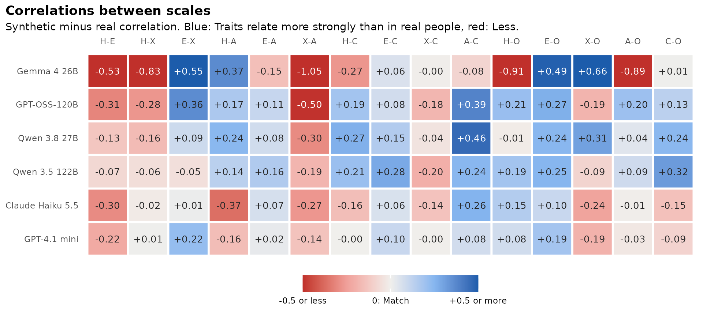
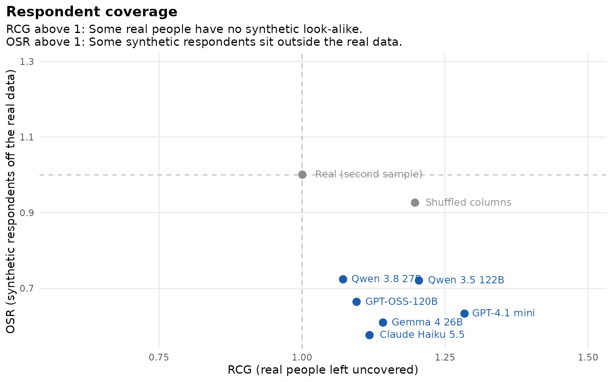
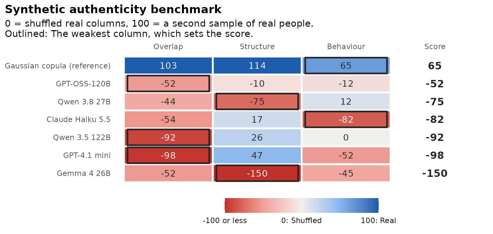

# Diagnostics beside the benchmark

The benchmark scores each model on Overlap, Structure and Behaviour.
Three diagnostics look at failures those columns can miss. They come
from recent studies of synthetic survey respondents, and they do not
change the benchmark score:

- [`synthetic_construct()`](https://www.okanbulut.com/synthcheck/reference/synthetic_construct.md):
  Do the scales hold together and relate to each other as they do in
  real people?
- [`respondent_coverage()`](https://www.okanbulut.com/synthcheck/reference/respondent_coverage.md):
  Does every real person have a synthetic look-alike, and do synthetic
  respondents stay inside the real data?
- [`synthetic_copula()`](https://www.okanbulut.com/synthcheck/reference/synthetic_copula.md)
  and `authenticity_benchmark(copula = TRUE)`: How does a generator with
  no language model do?

The diagnostics compare models and support decisions about them. They do
not show that synthetic data can replace a field test.

## The data

All 240 HEXACO items for Canada, with three attempts per model:

``` r

library(synthcheck)

real <- hexaco_real[hexaco_real$country == "Canada", ]
ca <- hexaco_llm[hexaco_llm$country == "Canada" & hexaco_llm$attempt <= 3, ]
synthetic <- as_synthetic_list(ca, items = hexaco_items$item)
```

## Construct structure

Structure averages over every pair of items, which is 28,680 pairs for
240 items. A model can do well there and still blur the six traits
together, or make every scale too coherent.
[`synthetic_construct()`](https://www.okanbulut.com/synthcheck/reference/synthetic_construct.md)
makes three checks for each scale and model:

- **Trait correlations:** `trait_cor_gap` is the mean absolute
  difference between the synthetic and the real correlations among the
  scale scores.
- **Reliability:** `alpha_gap` is the synthetic minus the real
  Cronbach’s alpha. Above 0 means the items hang together more tightly
  than in real people. That is the “too coherent” pattern, not a better
  result.
- **Loadings:** `phi` is Tucker’s congruence between the synthetic and
  the real one-factor loadings of each scale. Loadings of similar size
  give a high `phi` by chance, so each value is compared with a
  permutation null (`phi_null`). `rejects` is the share of scales whose
  `phi` is above chance.

``` r

cs <- synthetic_construct(synthetic, real, hexaco_items, n_perm = 100, n_splits = 10)
cs
#> Construct structure
#> 240 items in 6 scales, 1708 real respondents.
#> 
#>                 model attempts trait_cor_gap alpha_gap  phi phi_null rejects
#>           Gemma 4 26B        3          0.47     -0.02 0.75     0.71    0.72
#>          GPT-OSS-120B        3          0.24      0.04 0.94     0.91    0.67
#>          Qwen 3.8 27B        3          0.19      0.05 0.98     0.95    0.83
#>         Qwen 3.5 122B        3          0.17      0.01 0.96     0.92    0.94
#>      Claude Haiku 5.5        3          0.16     -0.01 0.94     0.91    0.50
#>          GPT-4.1 mini        3          0.11     -0.06 0.82     0.80    0.39
#>  Real (second sample)       10          0.04      0.00 1.00     0.94    1.00
#> 
#> trait_cor_gap: Mean |difference| of the correlations between scales. 
#> alpha_gap: Synthetic minus real alpha (above 0 = too coherent). 
#> phi: Tucker's congruence of the loadings; phi_null: Its value by chance; rejects: Share of scales with phi above chance (p < 0.05).
```

The “Real (second sample)” row shows how big the gaps are from sampling
noise alone. The correlations between traits show the largest
differences:

``` r

gg_construct(cs, "cor")
```



Red means two traits relate less strongly than in real people, blue more
strongly. `gg_construct(cs)` shows alpha per scale on the same colour
scale.

## Respondent coverage

Overlap looks at scale scores one scale at a time.
[`respondent_coverage()`](https://www.okanbulut.com/synthcheck/reference/respondent_coverage.md)
treats each respondent as one point, the keyed answers to all items, and
measures distances to the nearest neighbour (Kumagae & Kaneko, 2026):

- **RCG:** How far real people are from the nearest synthetic
  respondent. Above 1 means some real people have no synthetic
  look-alike.
- **OSR:** How far synthetic respondents are from the nearest real
  person. Above 1 means some synthetic respondents sit outside the real
  data.

Both ratios are scaled by the distance between real people, so a second
sample of real people gives about 1 on both.

``` r

rc <- respondent_coverage(synthetic, real, hexaco_items, n_draws = 3)
rc
#> Respondent coverage
#> 240 items, 1708 real respondents, 3 real samples per attempt.
#> 
#>                 model  RCG  OSR     pattern
#>          Qwen 3.8 27B 1.07 0.72  Human-like
#>          GPT-OSS-120B 1.10 0.66  Human-like
#>      Claude Haiku 5.5 1.12 0.58 Contraction
#>           Gemma 4 26B 1.14 0.61 Contraction
#>         Qwen 3.5 122B 1.20 0.72 Contraction
#>          GPT-4.1 mini 1.28 0.63 Contraction
#>  Real (second sample) 1.00 1.00  Human-like
#>      Shuffled columns 1.20 0.93 Contraction
#> 
#> Both ratios are near 1 for a second sample of real people.
```

``` r

gg_respondent_coverage(rc)
```



Every model has RCG above 1 and OSR below 1, which is the “contraction”
pattern. Synthetic respondents stay close to some real people, but they
leave others uncovered. `pattern` names it once RCG is more than `tol`
(0.1 by default) above 1, so the models closest to 1 are still labelled
“Human-like”. Synthetic respondents that were simply noisy would show up
as “off-support”, with both ratios above 1.

## A copula reference row

[`synthetic_copula()`](https://www.okanbulut.com/synthcheck/reference/synthetic_copula.md)
draws respondents from a Gaussian copula of the real data. It keeps each
item’s answer distribution and the correlations between items, and
nothing else. With `copula = TRUE`, the benchmark adds it as a row:

``` r

items <- hexaco_items[hexaco_items$trait %in% c("H", "C"), ]
bm <- authenticity_benchmark(synthetic, real, items, fit_scales = character(0),
                             n_splits = 10, n_floor = 10, copula = TRUE)
bm$table[, c("model", "reference", "score", "overlap", "structure", "behaviour")]
#> # A tibble: 7 × 6
#>   model                       reference  score overlap structure behaviour
#>   <chr>                       <lgl>      <dbl>   <dbl>     <dbl>     <dbl>
#> 1 Gaussian copula (reference) TRUE        64.6   103.      114.     64.6  
#> 2 GPT-OSS-120B                FALSE      -52.2   -52.2     -10.1   -12.1  
#> 3 Qwen 3.8 27B                FALSE      -74.6   -44.2     -74.6    11.9  
#> 4 Claude Haiku 5.5            FALSE      -81.8   -54.5      16.8   -81.8  
#> 5 Qwen 3.5 122B               FALSE      -92.3   -92.3      26.1     0.313
#> 6 GPT-4.1 mini                FALSE      -97.8   -97.8      47.4   -52.5  
#> 7 Gemma 4 26B                 FALSE     -150.    -52.4    -150.    -45.4
```

``` r

gg_benchmark(bm)
```



A model below the copula row does no better than this generator. Keep in
mind that the copula is fitted to the real data it is compared with.
That makes it an in-sample reference rather than a competitor, and it is
why its Overlap and Structure can go above 100. You can also use its
respondents on their own:

``` r

cop <- synthetic_copula(real, n = 500, items = hexaco_items, attempts = 2)
dim(cop[[1]])
#> [1] 500 240
```

## References

- Chidichimo, E., Jung, M. J., Wallis, F. P. S., & He, J. K. (2026).
  Artificial Societies Benchmark: A validation framework for synthetic
  research. [arXiv:2609.30030](https://arxiv.org/abs/2609.30030).
- Kumagae, Y., & Kaneko, M. (2026). Silicon samples match the answers
  but not the respondents.
  [arXiv:2610.30900](https://arxiv.org/abs/2610.30900).
- Lukauskas, M., & Šarkauskaitė, V. (2026). Plausible but not valid: A
  psychometric audit of LLMs as synthetic survey respondents.
  [arXiv:2608.14606](https://arxiv.org/abs/2608.14606).

## Next

[The synthetic authenticity
benchmark](https://www.okanbulut.com/synthcheck/articles/benchmark.md)
explains the three anchored columns these diagnostics sit beside.
