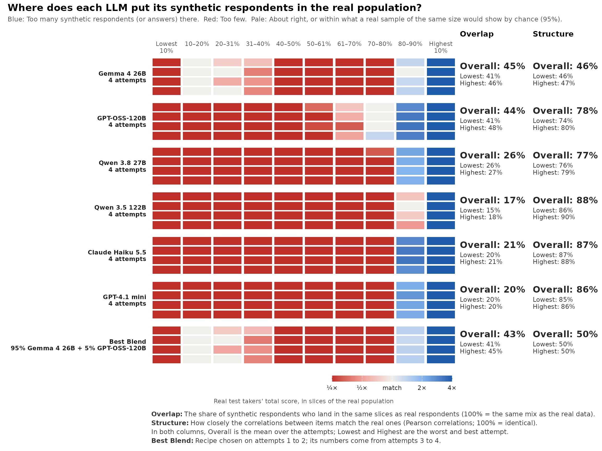
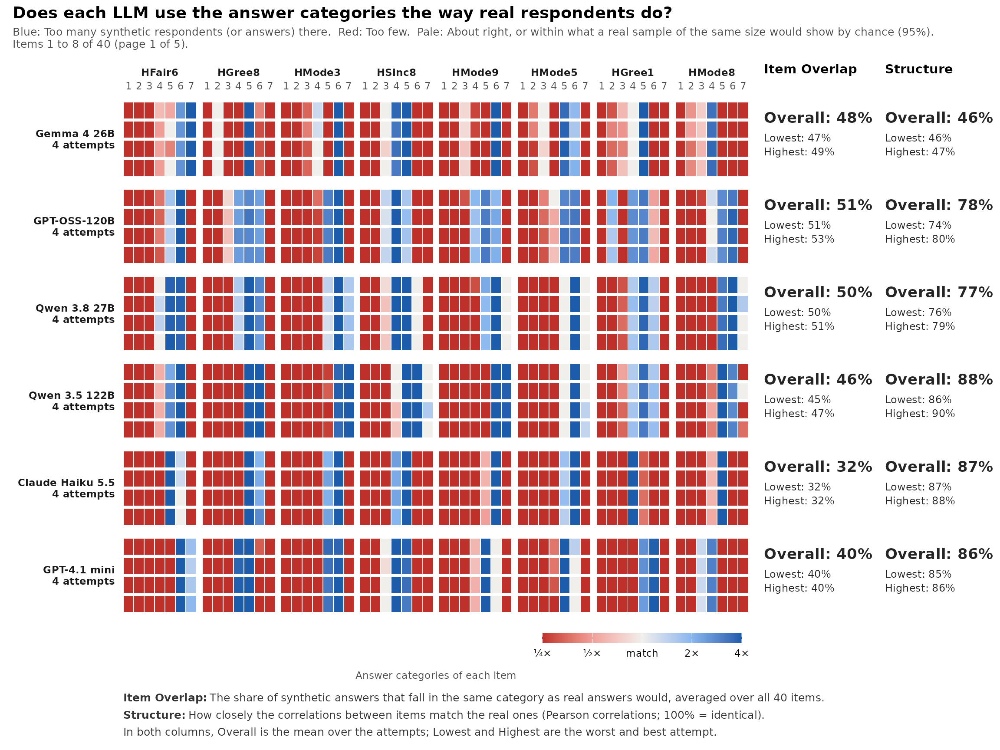

# Overlap and Structure: The coverage strip

**Experimental.** This tutorial walks through
[`synthetic_coverage()`](https://www.okanbulut.com/synthcheck/reference/synthetic_coverage.md),
[`gg_coverage()`](https://www.okanbulut.com/synthcheck/reference/gg_coverage.md)
and
[`blend_llms()`](https://www.okanbulut.com/synthcheck/reference/blend_llms.md):
Where synthetic respondents land compared with real people (Overlap),
and whether the items relate to each other as they do in real people
(Structure).

## Keyed data in the shape synthcheck expects

[`synthetic_coverage()`](https://www.okanbulut.com/synthcheck/reference/synthetic_coverage.md)
works on the answers you give it, so key the reverse-keyed items first.
HEXACO answers run from 1 to 7, so a reverse-keyed answer `x` becomes
`8 - x`:

``` r

library(synthcheck)

h <- hexaco_items$item[hexaco_items$trait == "H"]
rev_items <- intersect(h, hexaco_items$item[hexaco_items$reverse])
keyed <- function(d) { d <- d[h]; d[rev_items] <- 8 - d[rev_items]; d }

real <- keyed(hexaco_real[hexaco_real$country == "Canada", ])
ca <- hexaco_llm[hexaco_llm$country == "Canada" & hexaco_llm$attempt <= 4, ]
synthetic <- lapply(as_synthetic_list(ca), function(m) lapply(m, keyed))
str(synthetic, max.level = 1)
#> List of 6
#>  $ Gemma 4 26B     :List of 4
#>  $ GPT-OSS-120B    :List of 4
#>  $ Qwen 3.8 27B    :List of 4
#>  $ Qwen 3.5 122B   :List of 4
#>  $ Claude Haiku 5.5:List of 4
#>  $ GPT-4.1 mini    :List of 4
```

Each model has four attempts. An attempt is one full run of the
personas, so the spread over attempts shows how stable a model is.

## The coverage strip

``` r

cov <- synthetic_coverage(synthetic, real, cor = "pearson")
cov
#> <sc_coverage> 6 model(s), 40 item(s), coverage of real total-score slices (EXPERIMENTAL)
#>             model attempts overlap_overall overlap_lowest overlap_highest
#>       Gemma 4 26B        4             45%            41%             46%
#>      GPT-OSS-120B        4             44%            41%             48%
#>      Qwen 3.8 27B        4             26%            26%             27%
#>     Qwen 3.5 122B        4             17%            15%             18%
#>  Claude Haiku 5.5        4             21%            20%             21%
#>      GPT-4.1 mini        4             20%            20%             20%
#>        Best Blend        2             43%            41%             45%
#>  structure_overall structure_lowest structure_highest
#>                46%              46%               47%
#>                78%              74%               80%
#>                77%              76%               79%
#>                88%              86%               90%
#>                87%              87%               88%
#>                86%              85%               86%
#>                50%              50%               50%
#> 
#> Best Blend: 95% Gemma 4 26B + 5% GPT-OSS-120B (chosen on attempts 1 to 2; its numbers come from attempts 3 to 4)
#> 
#> * 1 real respondent(s) with missing answers are left out of the score
#>   slices.
```

``` r

gg_coverage(cov)
```



The columns are the deciles of the real total score, so each holds about
10% of real people. A row is one model and attempt. Red cells hold fewer
synthetic respondents than real people, blue cells hold more, and pale
cells are a match within the noise of a real sample of the same size.

Here every model has a blue right end and a red left end: It piles its
respondents into the top deciles of Honesty-Humility, so its synthetic
people are more honest and humble than real Canadians. Gemma 4 26B
spreads a little further down the scale than the others.

**Overlap** sums, slice by slice, the smaller of the synthetic and the
real share. 100% is the same mix as the real data. **Structure** is 100%
minus the mean absolute difference between the real and synthetic
inter-item correlations.

`cor = "pearson"` is fast. With the polycor package installed, the
default `cor = "auto"` uses polychoric correlations, which suit 7-point
items better but take longer on many items.

## Other slices

`slices` changes what the columns are:

- `"score"` (the default): Deciles of the real total score.
- `"theta"`: Deciles of a unidimensional IRT score fitted to the real
  data.
- `"group"`: One column per group, such as a country or a persona.
- `"item"`: One column per answer category of each item, to see which
  categories a model avoids.

``` r

cov_items <- synthetic_coverage(synthetic, real, slices = "item", cor = "pearson",
                                blend = FALSE)
gg_coverage(cov_items, items_per_plot = 8)
```



Items are ordered from the worst Item Overlap. Most models rarely use
the low categories that real people choose (red on the left of each
item) and pile their answers into one or two categories (blue).

With a grouping column, `within_group = TRUE` compares the shares within
each group, so that the mix of groups does not count. Use it when you
set the number of synthetic respondents per group by design.

## The best blend

With two or more models,
[`synthetic_coverage()`](https://www.okanbulut.com/synthcheck/reference/synthetic_coverage.md)
also searches for the mix of models that matches real people best.
`cov$blend` holds the recipe, and
[`blend_llms()`](https://www.okanbulut.com/synthcheck/reference/blend_llms.md)
searches again with other settings:

``` r

cov$blend$recipe
#> [1] "95% Gemma 4 26B + 5% GPT-OSS-120B"
b <- blend_llms(cov, step = 0.1, holdout = FALSE)
b$blend$weights
#>      Gemma 4 26B     GPT-OSS-120B     Qwen 3.8 27B    Qwen 3.5 122B 
#>              0.3              0.7              0.0              0.0 
#> Claude Haiku 5.5     GPT-4.1 mini 
#>              0.0              0.0
```

With four or more attempts per model, the recipe is chosen on half of
the attempts and reported on the other half, so the blend’s numbers are
not flattered by the search.

## Next

[Behaviour](https://www.okanbulut.com/synthcheck/articles/behaviour.md)
looks at how synthetic respondents answer, apart from what they answer.
