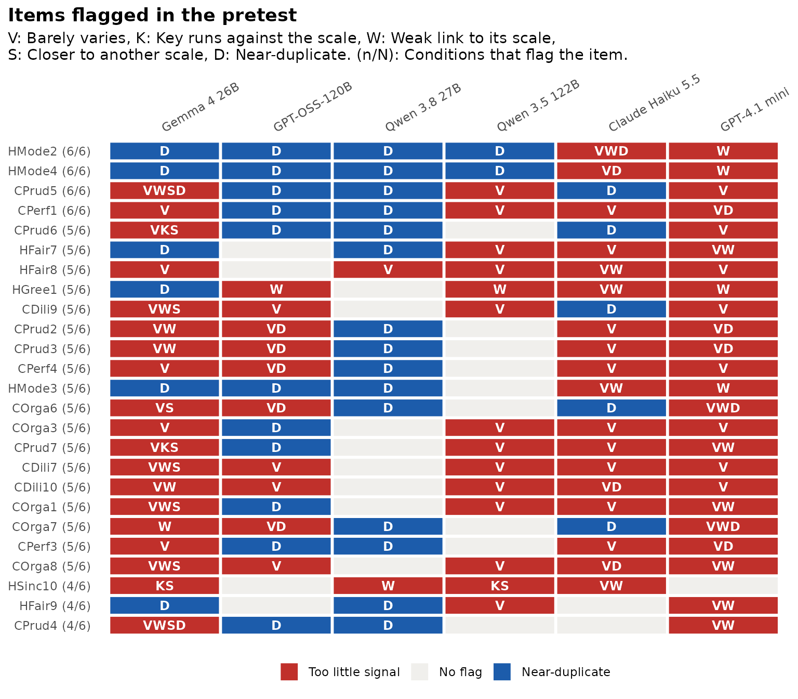
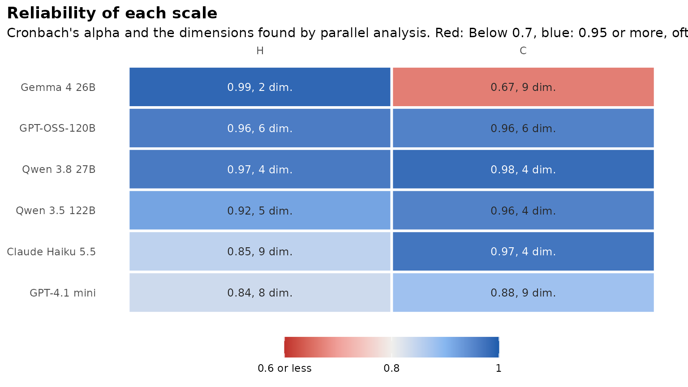

# Pretesting a scale without real data

**Experimental.** Most people who write a new scale have no real data
yet.
[`synthetic_pretest()`](https://www.okanbulut.com/synthcheck/reference/synthetic_pretest.md)
is for that stage. It runs a standard item analysis on synthetic
respondents and flags items worth a second look. It also asks two
questions that stand in for real data: Do the flags hold across models,
temperatures, prompt wordings and persona sets? And do the synthetic
answers recover the structure you designed?

This is **pilot screening, not validation**. Language models answer more
tidily than people do (see the [benchmark
article](https://www.okanbulut.com/synthcheck/articles/benchmark.md)),
so a clean pretest does not show that a scale works in people. Items
that fail even with tidy respondents are the ones to rewrite first.

## The data

The tutorial treats two HEXACO traits, Honesty-Humility (H) and
Conscientiousness (C), as if they were a new 80-item scale. The six
models in `hexaco_llm` are the conditions, with three attempts each:

``` r

library(synthcheck)

items <- hexaco_items[hexaco_items$trait %in% c("H", "C"), ]
synthetic <- hexaco_llm[hexaco_llm$country == "Canada" & hexaco_llm$attempt <= 3, ]
table(synthetic$model)
#> 
#>      Gemma 4 26B     GPT-OSS-120B     Qwen 3.8 27B    Qwen 3.5 122B 
#>             1500             1500             1450             1500 
#> Claude Haiku 5.5     GPT-4.1 mini 
#>             1500             1500
```

For your own scale, generate the data with
[`generate_synthetic()`](https://www.okanbulut.com/synthcheck/reference/generate_synthetic.md)
or the app (see [Generating synthetic respondents in
R](https://www.okanbulut.com/synthcheck/articles/generate.md)). The item
table needs `item` and `scale`, and `reverse` for reverse-keyed items.
Those columns are the structure the pretest checks.

## Run the pretest

``` r

pt <- synthetic_pretest(synthetic, items, by = "model", irt = FALSE)
pt
#> Pretest without real data (experimental): Pilot screening, not validation
#> 80 items in 2 scales, 6 conditions.
#> 
#>         condition attempts    n items flagged alpha scales n_factors own_scale
#>       Gemma 4 26B        3 1500    80      72  0.83      2         9      0.82
#>      GPT-OSS-120B        3 1500    80      51  0.96      2        11      1.00
#>      Qwen 3.8 27B        3 1450    80      20  0.97      2         7      1.00
#>     Qwen 3.5 122B        3 1500    80      24  0.94      2         9      0.99
#>  Claude Haiku 5.5        3 1500    80      70  0.91      2        12      1.00
#>      GPT-4.1 mini        3 1500    80      64  0.86      2        15      0.99
#>  reverse_ok
#>        0.89
#>        1.00
#>        1.00
#>        0.98
#>        1.00
#>        1.00
#> 
#> Flagged items (80), most often first:
#>    item scale flagged_in
#>  HMode2     H          6
#>  HMode4     H          6
#>  CPrud5     C          6
#>  CPerf1     C          6
#>  CPrud6     C          5
#>  HFair7     H          5
#>  HFair8     H          5
#>  HGree1     H          5
#>  CDili9     C          5
#>  CPrud2     C          5
#>                                                                            flags
#>                            Near-duplicate, Weak link to its scale, Barely varies
#>                            Near-duplicate, Barely varies, Weak link to its scale
#>   Near-duplicate, Barely varies, Weak link to its scale, Closer to another scale
#>                                                    Barely varies, Near-duplicate
#>  Near-duplicate, Barely varies, Reverse key not working, Closer to another scale
#>                            Barely varies, Near-duplicate, Weak link to its scale
#>                                            Barely varies, Weak link to its scale
#>                            Weak link to its scale, Barely varies, Near-duplicate
#>   Barely varies, Weak link to its scale, Closer to another scale, Near-duplicate
#>                            Barely varies, Near-duplicate, Weak link to its scale
#> ... and 70 more in `$agreement`.
#> 
#> flagged: Items with at least one flag; own_scale: Share of items closest to their own scale; 
#> reverse_ok: Share of reverse-keyed items whose key comes through; 
#> n_factors: Dimensions by parallel analysis over all items (designed: `scales`).
```

Each row of the summary is one condition: How many items it flags, the
mean alpha over scales, the number of dimensions parallel analysis finds
over all items (next to the two scales designed), the share of items
that relate most to their own scale, and the share of reverse-keyed
items whose key comes through.

`irt = TRUE` (the default) also fits a graded response model per scale
with mirt and flags items with a slope below 0.5. It is the slowest
step, so it is off here.

## Which items are flagged, and by how many models?

An item is flagged when it barely varies (SD below 0.5, or 90% of the
answers in one category), when its keyed answers run against the rest of
its scale, when its item-rest correlation is below 0.3, when it relates
more to another scale than to its own, or when it correlates 0.85 or
more with another item. `thresholds` changes any of these.

``` r

gg_pretest(pt, max_items = 25)
```



Red tiles are items with too little signal, blue tiles are
near-duplicates, and the label gives the number of models that flag the
item. `agreement` holds the same information as a table, most often
flagged first:

``` r

head(pt$agreement[, c("item", "scale", "flagged_in", "flags", "attempt_share")], 10)
#> # A tibble: 10 × 5
#>    item   scale flagged_in flags                                   attempt_share
#>    <chr>  <chr>      <int> <chr>                                           <dbl>
#>  1 HMode2 H              6 Near-duplicate, Weak link to its scale…         1    
#>  2 HMode4 H              6 Near-duplicate, Barely varies, Weak li…         1    
#>  3 CPrud5 C              6 Near-duplicate, Barely varies, Weak li…         0.944
#>  4 CPerf1 C              6 Barely varies, Near-duplicate                   0.944
#>  5 CPrud6 C              5 Near-duplicate, Barely varies, Reverse…         0.944
#>  6 HFair7 H              5 Barely varies, Near-duplicate, Weak li…         0.944
#>  7 HFair8 H              5 Barely varies, Weak link to its scale           0.889
#>  8 HGree1 H              5 Weak link to its scale, Barely varies,…         0.833
#>  9 CDili9 C              5 Barely varies, Weak link to its scale,…         0.833
#> 10 CPrud2 C              5 Barely varies, Near-duplicate, Weak li…         0.833
```

`attempt_share` is the share of single attempts that flag the item. A
flag that comes and goes between attempts of the same model may be
sampling noise.

Here most items are flagged by at least one model, and “Barely varies”
and “Near-duplicate” are the most common reasons. That is the tidy
answering of language models, not a property of 80 bad items. When this
happens, start with the items that most models agree on, and read “Weak
link” and “Reverse key not working” before the other flags.

## Do the conditions agree?

`stability` compares every pair of conditions: The rank correlation of
their item-rest correlations (`rho`) and the share of flagged items they
have in common (`jaccard`).

``` r

pt$stability
#> # A tibble: 15 × 4
#>    condition_a      condition_b          rho jaccard
#>    <chr>            <chr>              <dbl>   <dbl>
#>  1 Gemma 4 26B      GPT-OSS-120B      0.517    0.618
#>  2 Gemma 4 26B      Qwen 3.8 27B     -0.113    0.260
#>  3 Gemma 4 26B      Qwen 3.5 122B     0.0259   0.297
#>  4 Gemma 4 26B      Claude Haiku 5.5 -0.556    0.775
#>  5 Gemma 4 26B      GPT-4.1 mini     -0.110    0.744
#>  6 GPT-OSS-120B     Qwen 3.8 27B      0.221    0.246
#>  7 GPT-OSS-120B     Qwen 3.5 122B     0.262    0.271
#>  8 GPT-OSS-120B     Claude Haiku 5.5 -0.0347   0.613
#>  9 GPT-OSS-120B     GPT-4.1 mini      0.229    0.597
#> 10 Qwen 3.8 27B     Qwen 3.5 122B     0.560    0.257
#> 11 Qwen 3.8 27B     Claude Haiku 5.5  0.429    0.25 
#> 12 Qwen 3.8 27B     GPT-4.1 mini      0.184    0.273
#> 13 Qwen 3.5 122B    Claude Haiku 5.5  0.380    0.270
#> 14 Qwen 3.5 122B    GPT-4.1 mini      0.191    0.333
#> 15 Claude Haiku 5.5 GPT-4.1 mini      0.220    0.718
```

On HEXACO the models agree only in part: Some pairs rank the items
alike, and others not at all. Low agreement is a finding too: It means a
different model would have told you to fix different items. The same
comparison works for temperatures, prompt wordings or persona sets. Give
each run its own label and pass that column as `by`, or several columns,
as in `by = c("model", "wording")`. In the app, “Or several
temperatures” in the Models tab adds one model per temperature.

## Does the designed structure come back?

``` r

pt$summary[, c("condition", "scales", "n_factors", "own_scale", "reverse_ok")]
#> # A tibble: 6 × 5
#>   condition        scales n_factors own_scale reverse_ok
#>   <chr>             <int>     <int>     <dbl>      <dbl>
#> 1 Gemma 4 26B           2         9     0.823      0.891
#> 2 GPT-OSS-120B          2        11     1          1    
#> 3 Qwen 3.8 27B          2         7     1          1    
#> 4 Qwen 3.5 122B         2         9     0.988      0.979
#> 5 Claude Haiku 5.5      2        12     1          1    
#> 6 GPT-4.1 mini          2        15     0.987      1
gg_pretest(pt, "scales")
```



Almost every item relates most to the scale it was written for, and the
reverse keys come through. Parallel analysis finds more dimensions than
the two scales, because each HEXACO trait has four facets; the real data
below give more than two as well. The scale plot shows the tidy answers
again: Alpha is 0.95 or more for many models, higher than real people
give.

## Plain language

``` r

summarise_pretest(pt)
#> Pretest without real data, in plain language (experimental)
#> 
#> This is pilot screening on synthetic respondents only. It flags items
#> worth a second look; it does not show that the scale works in people.
#> 
#> 80 of 80 items are flagged in at least one condition, and 4 in all 6
#> conditions. Flagged most often: HMode2 (near-duplicate, weak link to
#> its scale, barely varies), HMode4 (near-duplicate, barely varies, weak
#> link to its scale), CPrud5 (near-duplicate, barely varies, weak link to
#> its scale, closer to another scale), CPerf1 (barely varies,
#> near-duplicate) and CPrud6 (near-duplicate, barely varies, reverse key
#> not working, closer to another scale). 13 of the flagged items are
#> flagged in fewer than half of the single attempts, so their flags may
#> be sampling noise. When most items are flagged, the flags describe the
#> model's tidy answers as much as the items. Start with the items that
#> most conditions agree on.
#> 
#> The conditions disagree on which items link weakly to their scale (mean
#> rank correlation 0.16) and share 43% of their flagged items on average.
#> 
#> 82% to 100% of the items relate most to the scale they were written for
#> (range over conditions). The reverse key comes through for 89% to 100%
#> of the reverse-keyed items. You designed 2 scales; parallel analysis
#> finds 7 to 15 dimensions over all items.
#> 
#> Alpha is below 0.7 for C in Gemma 4 26B. Alpha is 0.95 or higher in 7
#> of 12 scale results. Synthetic respondents are often more consistent
#> than people, so expect lower values in real data.
```

## How well do the flags match real people?

The HEXACO data come with real responses, so this tutorial can check
what the pretest would have found in people.
[`synthetic_pretest()`](https://www.okanbulut.com/synthcheck/reference/synthetic_pretest.md)
works on any data:

``` r

real <- hexaco_real[hexaco_real$country == "Canada", ]
pr <- synthetic_pretest(real, items, by = NULL, irt = FALSE)
real_flags <- pr$items[pr$items$weak | pr$items$key, c("item", "item_rest", "flags")]
real_flags
#> # A tibble: 7 × 3
#>   item    item_rest flags                                           
#>   <chr>       <dbl> <chr>                                           
#> 1 HSinc9     0.215  Weak link to its scale                          
#> 2 HSinc10   -0.0588 Reverse key not working, Closer to another scale
#> 3 HFair5     0.227  Weak link to its scale                          
#> 4 HGree2     0.158  Weak link to its scale                          
#> 5 HGree7     0.280  Weak link to its scale                          
#> 6 HGree9     0.297  Weak link to its scale                          
#> 7 HMode8     0.289  Weak link to its scale
```

How many of the six models flag these items as weak or running against
their scale?

``` r

it <- as.data.frame(pt$items)
it$weak_or_key <- it$weak | it$key
n_models <- tapply(it$weak_or_key, it$item, sum)
data.frame(item = real_flags$item, models = n_models[real_flags$item])
#>            item models
#> HSinc9   HSinc9      1
#> HSinc10 HSinc10      4
#> HFair5   HFair5      2
#> HGree2   HGree2      4
#> HGree7   HGree7      4
#> HGree9   HGree9      1
#> HMode8   HMode8      2
```

And how closely do the item-rest correlations of each model follow the
real ones (rank correlation)?

``` r

real_ir <- setNames(pr$items$item_rest, pr$items$item)
sapply(split(it, it$condition), function(d)
  round(cor(d$item_rest, real_ir[d$item], method = "spearman", use = "complete.obs"), 2))
#> Claude Haiku 5.5      Gemma 4 26B     GPT-4.1 mini     GPT-OSS-120B 
#>             0.37            -0.05             0.20             0.18 
#>    Qwen 3.5 122B     Qwen 3.8 27B 
#>             0.48             0.45
```

The models catch some of the items that are weak in people, and they
agree with real people on the ranking of the items only in part. That is
why the pretest is screening: It points at items to read again, and a
field test still decides.

## Later: Real data

The pretest keeps the item table in `pt$settings$items`. Once real
responses come in, the same synthetic data go straight into the
benchmark, and the app lets you switch the first question to “Yes, I
have real data”:

``` r

real <- read.csv("my_real_data.csv")
authenticity_benchmark(as_synthetic_list(synthetic), real, pt$settings$items)
```
