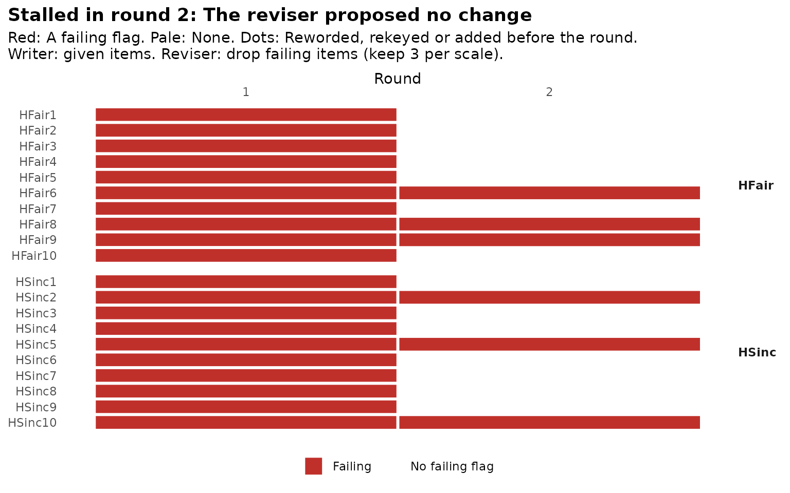

# Revising items in a loop: Write, answer, check, revise

Can a language model write a scale, see how synthetic respondents answer
it, and revise it until it looks polished? And if so, after how many
rounds, and do its revisions follow the evidence?
[`revision_loop()`](https://www.okanbulut.com/synthcheck/reference/revision_loop.md)
runs that experiment and logs every step, so the questions can be
answered from data.

Like the
[pretest](https://www.okanbulut.com/synthcheck/articles/pretest.md),
this is **pilot screening, not validation**. Items that look polished to
synthetic respondents still need a field test with people. If the same
model family writes and answers the items, “polished” may only mean
“easy for language models to agree with”, so cross the writer and
respondent models and check the final items in a small real sample.

## The loop

Each round has four steps:

1.  **Answer.** Synthetic respondents answer the current items
    ([`generate_synthetic()`](https://www.okanbulut.com/synthcheck/reference/generate_synthetic.md)).
2.  **IRT checks.**
    [`loop_irt()`](https://www.okanbulut.com/synthcheck/reference/loop_irt.md)
    fits the partial credit model to each scale with mirt and flags
    items with infit or outfit mean squares outside 0.6 to 1.4, S-X2
    misfit, disordered thresholds, local dependence (Q3) and items
    nobody varies on. `loop_irt("gpcm")` and `loop_irt("graded")` fit
    models with a slope per item and flag low slopes instead.
3.  **Data quality.**
    [`loop_checker()`](https://www.okanbulut.com/synthcheck/reference/loop_checker.md)
    runs the item analysis of
    [`synthetic_pretest()`](https://www.okanbulut.com/synthcheck/reference/synthetic_pretest.md)
    (weak items, keys that run against the scale, items closer to
    another scale, near-duplicates) and screens the respondents for
    straight-lining, ignored keys and skipped items.
4.  **Stop or revise.**
    [`loop_criterion()`](https://www.okanbulut.com/synthcheck/reference/loop_criterion.md)
    decides whether the items are polished. If they are not, a reviser
    proposes edits (reword, rekey, drop, add or keep), and the next
    round starts with the edited items.

The loop stops when the criterion passes, when `max_rounds` is reached,
when the reviser proposes no change, or when a step fails. The first
items come from you (`items`) or from a writer
([`loop_writer_llm()`](https://www.okanbulut.com/synthcheck/reference/loop_writer_llm.md)).

## Decide what “polished” means first

Set the stopping rule before the first run, so that the number of rounds
means something. The default asks for no item with a failing flag, alpha
of at least 0.80 in every scale, at least 90% of items closest to their
own scale, at most 5% unusable respondents and at least three items per
scale:

``` r

library(synthcheck)
loop_criterion()
#> function (flags, stats, items, context) 
#> {
#>     rows <- list()
#>     add <- function(name, value, target, pass) rows[[length(rows) + 
#>         1L]] <<- data.frame(criterion = name, value = value, 
#>         target = target, pass = pass, stringsAsFactors = FALSE)
#>     if (no_failing_items) {
#>         n <- length(unique(flags$item[flags$severity == "fail" & 
#>             !is.na(flags$item)]))
#>         add("no_failing_items", n, 0, n == 0)
#>     }
#>     for (s in names(min)) {
#>         v <- stats$value[stats$stat == s]
#>         v <- if (length(v) && any(!is.na(v))) 
#>             min(v, na.rm = TRUE)
#>         else NA_real_
#>         add(paste0("min_", s), v, min[[s]], !is.na(v) && v >= 
#>             min[[s]])
#>     }
#>     for (s in names(max)) {
#>         v <- stats$value[stats$stat == s]
#>         v <- if (length(v) && any(!is.na(v))) 
#>             max(v, na.rm = TRUE)
#>         else NA_real_
#>         add(paste0("max_", s), v, max[[s]], !is.na(v) && v <= 
#>             max[[s]])
#>     }
#>     if (!is.null(min_items)) {
#>         n <- min(table(items$scale))
#>         add("min_items", n, min_items, n >= min_items)
#>     }
#>     if (factors) {
#>         v <- stats$value[stats$stat == "n_factors_all"][1]
#>         k <- length(unique(items$scale))
#>         add("factors", v, k, !is.na(v) && v == k)
#>     }
#>     if (!length(rows)) 
#>         return(NULL)
#>     do.call(rbind, rows)
#> }
#> <bytecode: 0x649132d97b28>
#> <environment: 0x649132d90998>
#> attr(,"label")
#> [1] "no failing items; alpha >= 0.8; own_scale >= 0.9; careless_share <= 0.05; at least 3 items per scale"
```

Any stat a step reports can be a target, for example the marginal
reliability from
[`loop_irt()`](https://www.okanbulut.com/synthcheck/reference/loop_irt.md):

``` r

crit <- loop_criterion(min = list(alpha = 0.8, own_scale = 0.9, marginal_rxx = 0.8),
                       factors = TRUE)
```

## A first run

The mock provider answers at random, so every item fails. That makes it
a quick way to see the loop and its log without calling a model. Here
the rules-based reviser
[`loop_reviser_drop()`](https://www.okanbulut.com/synthcheck/reference/loop_reviser_drop.md)
drops failing items until each scale is down to three:

``` r

h <- hexaco_items[hexaco_items$facet %in% c("HSinc", "HFair"), ]
h$scale <- h$facet
con <- loop_construct("Honesty-Humility", "Sincerity and fairness in dealing with others.",
                      scales = c(HSinc = "Sincerity", HFair = "Fairness"), scale = c(1, 7))
run <- revision_loop(con, h, sc_model("mock"), respondents = 60, max_rounds = 4,
                     checker = loop_checker(n_pa = 5), cache = FALSE)
run
#> Item-revision loop "Honesty_Humility-seed1": stalled after 2 rounds
#> Writer: given items
#> Evaluator: mirt partial credit model (infit and outfit, threshold order, S-X2, Q3, information)
#> Checker: synthcheck data quality (pretest and respondent screening)
#> Reviser: drop failing items (keep 3 per scale)
#> Stopping rule: no failing items; alpha >= 0.8; own_scale >= 0.9; careless_share <= 0.05; at least 3 items per scale
#> 
#>  round n_items n_failing n_passed n_criteria    stop
#>      1      20        20        2          5    <NA>
#>      2       6         6        2          5 stalled
#> 
#> Edits: 14 drop.
#> 
#> The tables `rounds`, `items`, `flags`, `stats`, `criteria` and `edits` hold the log; 
#> see loop_log_schema().
```

``` r

gg_loop(run)
```



## A run with language models

The target instrument is a new scale of **financial well-being**, built
on the definition of the Consumer Financial Protection Bureau (2015).
Its four elements are the scales: Control over day-to-day finances, a
cushion against financial shocks, being on track to meet financial
goals, and the freedom to make choices that let one enjoy life.
[`loop_builtin_construct()`](https://www.okanbulut.com/synthcheck/reference/loop_builtin_construct.md)
has it ready:

``` r

fwb <- loop_builtin_construct("financial_wellbeing", n_per_scale = 8,
                              population = "adults in Canada")
fwb
#> Construct "Financial well-being": 4 scales, 8 items each, answers 1 to 5.
#> A state in which a person can fully meet current and ongoing financial obligations, can feel secure in their financial future, and is able to make choices that allow them to enjoy life. 
#>   control: Having control over one's finances: Being able to pay bills on time, not having unmanageable debt, and being able to make ends meet.
#>   cushion: Having a financial cushion against unexpected expenses and emergencies: Savings, health insurance and good credit, and being able to rely on friends and family for financial help, which increase the capacity to absorb a financial shock.
#>   goals: Having financial goals, such as paying off student loans within a certain number of years or saving a particular amount toward retirement, and being on track to meet them.
#>   freedom: Being able to make choices that allow one to enjoy life, such as taking a vacation, enjoying a meal out now and then, going back to school for an advanced degree, or working less to spend more time with family.
```

It carries its own stopping rule: The defaults plus a marginal
reliability of at least 0.80 in every scale and four dimensions in
parallel analysis.

In a real run, one model writes and revises the items and another
answers them:

``` r

author <- sc_model("openai", "gpt-4.1-mini")
run <- revision_loop(fwb, models = sc_model("anthropic"), respondents = 200,
                     writer = loop_writer_llm(author), reviser = loop_reviser_llm(author),
                     max_rounds = 15, parallel = 10,
                     output = "loops/fwb/openai-writes_claude-answers/seed1", seed = 1)
```

See what a round of respondents costs first with
[`estimate_cost()`](https://www.okanbulut.com/synthcheck/reference/estimate_cost.md).
The response cache
([`sc_cache()`](https://www.okanbulut.com/synthcheck/reference/sc_cache.md))
makes a repeated run free.

## What the log records

Every run writes seven tables, which
[`loop_log_schema()`](https://www.okanbulut.com/synthcheck/reference/loop_log_schema.md)
documents column by column:

``` r

unique(loop_log_schema()$table)
#> [1] "runs"     "rounds"   "items"    "flags"    "stats"    "criteria" "edits"
loop_log_schema("edits")[, c("column", "description")]
#> # A tibble: 16 × 2
#>    column        description                                                    
#>    <chr>         <chr>                                                          
#>  1 run_id        Name of the run.                                               
#>  2 round         Round whose checks prompted the edit; it takes effect in the n…
#>  3 item          Item edited (the new name for an added item).                  
#>  4 action        reword, rekey, drop, add or keep.                              
#>  5 old_statement Wording before the edit.                                       
#>  6 new_statement Wording after the edit.                                        
#>  7 old_reverse   Key before the edit.                                           
#>  8 new_reverse   Key after the edit.                                            
#>  9 scale         Scale of the item.                                             
#> 10 rationale     Why the reviser made the edit.                                 
#> 11 cites         Checks the edit responds to, separated by commas.              
#> 12 cites_flagged Were all cited checks flagged on this item in this round? NA w…
#> 13 resolved      Are the cited checks (or, with none cited, all failing checks)…
#> 14 similarity    Word overlap (Jaccard) of the old and new wording, 1 for no ch…
#> 15 applied       Was the edit applied? FALSE for unknown items or a second edit…
#> 16 note          Why an edit was not applied.
```

- `runs`: The settings, the step labels, the writer’s note and the final
  status.
- `rounds`: Per round, the number of items, failing items and passed
  criteria, the cost and tokens, and the reviser’s note on the round.
- `items`: Every item in every round, with its wording, version and
  flags.
- `flags` and `stats`: Every flag and statistic, from each step.
- `criteria`: Every part of the stopping rule in every round.
- `edits`: Every edit, with its rationale, the checks it cites, whether
  those checks were in fact flagged (`cites_flagged`), whether they were
  gone in the next round (`resolved`) and how much of the wording
  changed (`similarity`).

The last table carries the reasoning questions. `cites_flagged` asks
whether the stated rationale matches the evidence. `resolved` asks
whether the fix worked. An edit that resolved its check, followed by the
same check on the same item a few rounds later, is oscillation. A
falling `similarity` across rounds is drift away from the starting
wording, and a rising alpha together with near-duplicate flags is a sign
of items converging on the same bland statement.

## Running an experiment

One run is an anecdote. A design crosses the factors that matter, with
several replications (seeds) per cell:

- the construct (a new one, such as financial well-being, against an
  established one with known items, such as HEXACO facets),
- the writer and reviser model,
- the respondent model (the same family as the writer, or a different
  one),
- the reviser (a language model against
  [`loop_reviser_drop()`](https://www.okanbulut.com/synthcheck/reference/loop_reviser_drop.md),
  which shows how far deletion alone gets),
- the persona mix.

Give each run its own folder and `run_id`, then read them all back:

``` r

design <- expand.grid(author = c("openai", "anthropic"), respondent = c("openai", "anthropic"),
                      seed = 1:5, stringsAsFactors = FALSE)
for (i in seq_len(nrow(design))) {
  d <- design[i, ]
  author <- sc_model(d$author)
  id <- sprintf("%s-writes_%s-answers_seed%d", d$author, d$respondent, d$seed)
  revision_loop(fwb, models = sc_model(d$respondent), respondents = 200,
                writer = loop_writer_llm(author), reviser = loop_reviser_llm(author),
                max_rounds = 15, parallel = 10, output = file.path("loops", id), run_id = id, seed = d$seed)
}
runs <- read_loop("loops")
```

[`loop_outcomes()`](https://www.okanbulut.com/synthcheck/reference/loop_outcomes.md)
gives one row per run: The round in which the items were polished, the
edits by action, the share of edits that cited flagged checks and that
resolved them, relapses, wording drift and cost. Join it with the design
to compare cells:

``` r

loop_outcomes(run)
#> # A tibble: 1 × 18
#>   run_id      status rounds rounds_to_polish items_start items_end failing_start
#>   <chr>       <chr>   <int>            <int>       <int>     <int>         <int>
#> 1 Honesty_Hu… stall…      2               NA          20         6            20
#> # ℹ 11 more variables: failing_end <int>, edits <int>, reworded <int>,
#> #   rekeyed <int>, dropped <int>, added <int>, cites_flagged <dbl>,
#> #   resolved <dbl>, relapsed <dbl>, similarity <dbl>, cost <dbl>
```

Finally, give the final items of a few runs to a small sample of people
and compare them with
[`authenticity_benchmark()`](https://www.okanbulut.com/synthcheck/reference/authenticity_benchmark.md)
and
[`synthetic_pretest()`](https://www.okanbulut.com/synthcheck/reference/synthetic_pretest.md)
on the real answers. That is the only way to tell whether synthetic
polish carries over to people.
