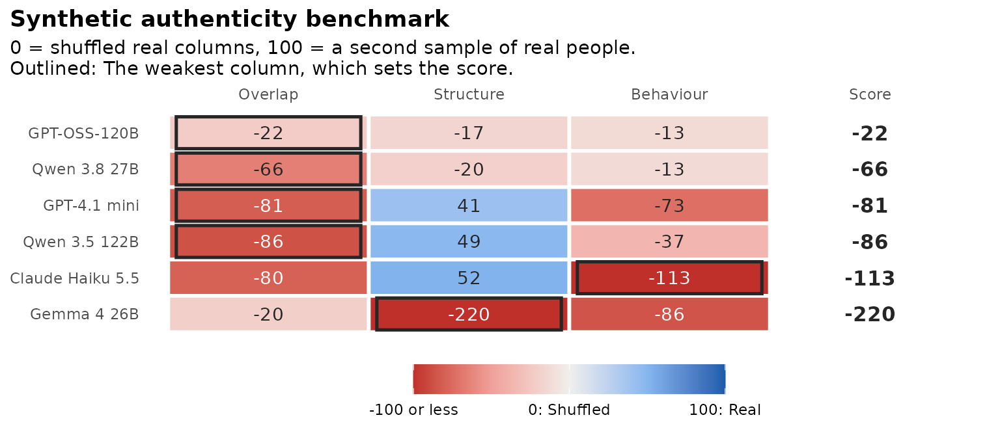

# Get started

**Experimental.** synthcheck checks whether synthetic survey respondents
made by large language models resemble the real people they stand in
for. It compares models and supports decisions about them. It does not
show that synthetic data can replace a field test.

This article runs the whole workflow once, on a small slice of the data
that ships with the package. The other tutorials take each step in turn.

## The question in three parts

synthcheck looks at three things, and anchors each of them between a
shuffled baseline (0) and a second sample of real people (100):

- **Overlap:** Do synthetic respondents land where real people land?
- **Structure:** Do the items relate to each other as they do in real
  people?
- **Behaviour:** Do synthetic respondents answer the way people do?

The **synthetic authenticity benchmark** puts the three columns in one
table, one row per model, and scores each model by its weakest column.

## The data

``` r

library(synthcheck)

dim(hexaco_real)
#> [1] 17874   241
table(hexaco_llm$model)
#> 
#>      Gemma 4 26B     GPT-OSS-120B     Qwen 3.8 27B    Qwen 3.5 122B 
#>            15000            15000            14611            15000 
#> Claude Haiku 5.5     GPT-4.1 mini 
#>            15000            14986
head(hexaco_items)
#>     item trait      trait_label facet facet_label
#> 1 HSinc1     H Honesty-Humility HSinc   Sincerity
#> 2 HSinc2     H Honesty-Humility HSinc   Sincerity
#> 3 HSinc3     H Honesty-Humility HSinc   Sincerity
#> 4 HSinc4     H Honesty-Humility HSinc   Sincerity
#> 5 HSinc5     H Honesty-Humility HSinc   Sincerity
#> 6 HSinc6     H Honesty-Humility HSinc   Sincerity
#>                                                                                 statement
#> 1                                                   I don't pretend to be more than I am.
#> 2                                                            I use flattery to get ahead.
#> 3 I tell other people what they want to hear so that they will do what I want them to do.
#> 4                                                      I put on a show to impress people.
#> 5                                              I switch my loyalties when I feel like it.
#> 6                                               I play a role in order to impress people.
#>   reverse
#> 1   FALSE
#> 2    TRUE
#> 3    TRUE
#> 4    TRUE
#> 5    TRUE
#> 6    TRUE
```

`hexaco_real` holds real answers to the 240 IPIP-HEXACO items on a 1 to
7 scale. `hexaco_llm` holds the same items answered by six language
models, ten attempts per country. `hexaco_items` describes each item:
Its trait, facet and whether it is reverse-keyed.

Synthetic data go into synthcheck as a named list with one element per
model, each a list of attempts.
[`as_synthetic_list()`](https://www.okanbulut.com/synthcheck/reference/as_synthetic_list.md)
builds that list from a long table with `model` and `attempt` columns:

``` r

h <- hexaco_items[hexaco_items$trait == "H", ]   # Honesty-Humility, 40 items
real <- hexaco_real[hexaco_real$country == "Canada", ]
ca <- hexaco_llm[hexaco_llm$country == "Canada" & hexaco_llm$attempt <= 3, ]
synthetic <- as_synthetic_list(ca, items = h$item)
lengths(synthetic)
#>      Gemma 4 26B     GPT-OSS-120B     Qwen 3.8 27B    Qwen 3.5 122B 
#>                3                3                3                3 
#> Claude Haiku 5.5     GPT-4.1 mini 
#>                3                3
```

## One table, one picture

``` r

bm <- authenticity_benchmark(synthetic, real, h, n_splits = 10, n_floor = 10)
bm
#> Synthetic authenticity benchmark (experimental)
#> 40 items, 1708 real respondents. Score: weakest.
#> 
#>             model attempts Overlap Structure Behaviour Score   Weakest
#>      GPT-OSS-120B        3     -22       -17       -13   -22   Overlap
#>      Qwen 3.8 27B        3     -66       -20       -13   -66   Overlap
#>      GPT-4.1 mini        3     -81        41       -73   -81   Overlap
#>     Qwen 3.5 122B        3     -86        49       -37   -86   Overlap
#>  Claude Haiku 5.5        3     -80        52      -113  -113 Behaviour
#>       Gemma 4 26B        3     -20      -220       -86  -220 Structure
#> 
#> Anchors (raw, floor to ceiling, samples of 500): Overlap 52.8 to 93.3, Structure 79.6 to 94.8, Behaviour 66.7 to 92.2.
#> 0 = shuffled real columns, 100 = a second sample of real people.
```

``` r

gg_benchmark(bm)
```



Each tile runs from red (-100 or lower, far worse than shuffled columns)
through pale (around 0, no better than shuffled columns) to blue (100,
as close as a second sample of real people). The outlined tile is each
model’s weakest column, which sets the score at the right.

Values below 0 are common: The floor is built from the real data, which
a language model never sees, so it is a strict baseline. A negative
value means the model’s respondents are further from real people than
respondents pieced together from shuffled real answers, for example
because they bunch into fewer score deciles.

[`summarise_benchmark()`](https://www.okanbulut.com/synthcheck/reference/summarise_benchmark.md)
turns the table into a few sentences per model, written by fixed rules
from the values in the table:

``` r

summarise_benchmark(bm)
#> Synthetic authenticity benchmark in plain language (experimental)
#> 
#> GPT-OSS-120B scores -22 on the benchmark (1st of 6), set by its weakest
#> column, Overlap. Overlap is -22 (worse than shuffled columns);
#> Structure is -17 (worse than shuffled columns); Behaviour is -13 (worse
#> than shuffled columns). Compared with real people, they fit the
#> response model better (behaviour overlap 43) and they answer
#> reverse-keyed items more consistently (behaviour overlap 47).
#> 
#> Qwen 3.8 27B scores -66 on the benchmark (2nd of 6), set by its weakest
#> column, Overlap. Overlap is -66 (worse than shuffled columns);
#> Structure is -20 (worse than shuffled columns); Behaviour is -13 (worse
#> than shuffled columns). Compared with real people, they answer
#> reverse-keyed items more consistently (behaviour overlap 42) and they
#> agree less overall (behaviour overlap 42).
#> 
#> GPT-4.1 mini scores -81 on the benchmark (3rd of 6), set by its weakest
#> column, Overlap. Overlap is -81 (worse than shuffled columns);
#> Structure is 41 (closer to shuffled columns than to real people);
#> Behaviour is -73 (worse than shuffled columns). Compared with real
#> people, their answers are more consistent within facets (behaviour
#> overlap 30) and they fit the response model better (behaviour overlap
#> 33).
#> 
#> Qwen 3.5 122B scores -86 on the benchmark (4th of 6), set by its
#> weakest column, Overlap. Overlap is -86 (worse than shuffled columns);
#> Structure is 49 (closer to shuffled columns than to real people);
#> Behaviour is -37 (worse than shuffled columns). Compared with real
#> people, they answer reverse-keyed items more consistently (behaviour
#> overlap 31) and they agree less overall (behaviour overlap 35).
#> 
#> Claude Haiku 5.5 scores -113 on the benchmark (5th of 6), set by its
#> weakest column, Behaviour. Overlap is -80 (worse than shuffled
#> columns); Structure is 52 (partly like real people); Behaviour is -113
#> (worse than shuffled columns). Compared with real people, they fit the
#> response model better (behaviour overlap 25) and they agree less
#> overall (behaviour overlap 29).
#> 
#> Gemma 4 26B scores -220 on the benchmark (6th of 6), set by its weakest
#> column, Structure. Overlap is -20 (worse than shuffled columns);
#> Structure is -220 (worse than shuffled columns); Behaviour is -86
#> (worse than shuffled columns). Compared with real people, they fit the
#> response model better (behaviour overlap 33) and their answers are more
#> consistent within facets (behaviour overlap 35).
#> 
#> 100 = as close as a second sample of real people; 0 = no better than shuffled columns.
```

## Where to go next

- [Overlap and
  Structure](https://www.okanbulut.com/synthcheck/articles/overlap-structure.md):
  The coverage strip, item by item and score slice by score slice.
- [Behaviour](https://www.okanbulut.com/synthcheck/articles/behaviour.md):
  The eight features of how people answer, and careless real
  respondents.
- [The
  benchmark](https://www.okanbulut.com/synthcheck/articles/benchmark.md):
  Anchors, scores and the choices behind the table.
- [Generating synthetic
  respondents](https://www.okanbulut.com/synthcheck/articles/generate.md):
  Your own instrument, personas and models, in R code.
- [A tour of the
  app](https://www.okanbulut.com/synthcheck/articles/app-tour.md) and
  the [app
  demo](https://www.okanbulut.com/synthcheck/articles/app-demo.md): The
  same workflow without writing code.
