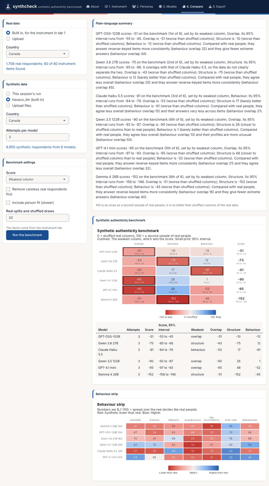
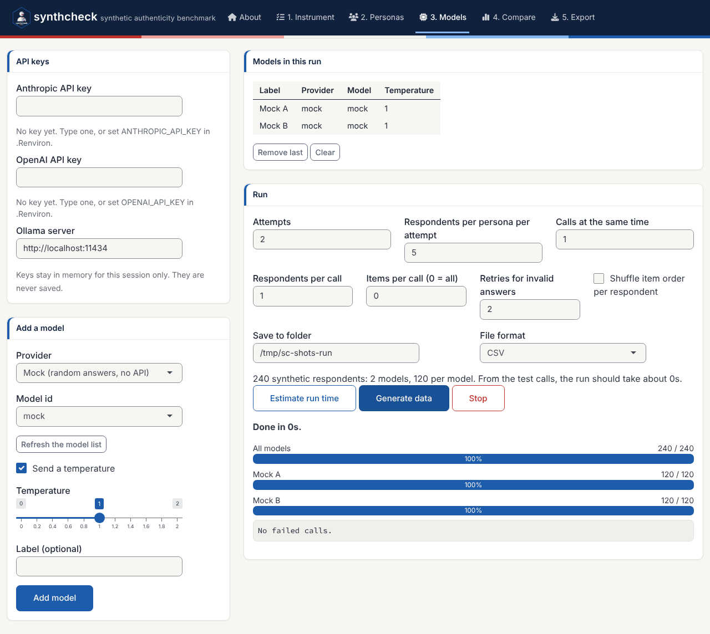
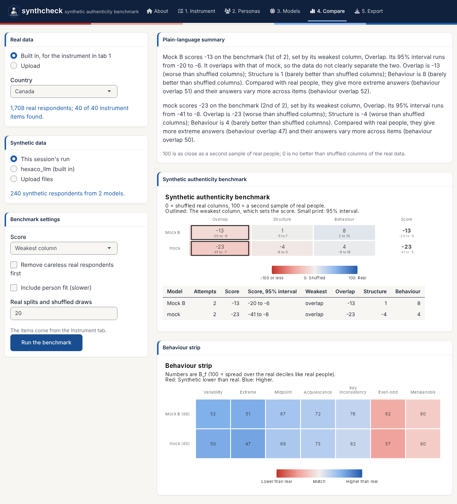

**Experimental.** These demos walk through the app from start to finish.
The first two need no API key, so you can try them right away. The third is
a real run with your own questionnaire. For what every control does, see
[the tour of the app](app-tour.html).

```r
library(synthcheck)
run_synthcheck_app()
```

The app opens on the **About** tab. Click **Start with the instrument** to
go straight to the first step, or **Take the guided tour** for a
walkthrough that points to each control in turn (it needs the cicerone
package). The demos below start on the Instrument tab.

## Demo 1: Benchmark the six built-in models

The package ships synthetic answers from six language models to the
IPIP-HEXACO items (`hexaco_llm`), so you can run the benchmark without
generating anything.

1. **Instrument:** Keep **IPIP-HEXACO (built in)** and the traits
   Honesty-Humility and Conscientiousness (80 items).
2. **Compare:** Under *Real data*, choose **hexaco_real (built in)** and
   *Canada*. Under *Synthetic data*, choose **hexaco_llm (built in)**,
   *Canada* and 3 attempts per model.
3. Switch off **Include person fit** for a faster first run, and click
   **Run the benchmark**.



The summary names each model's score and its weakest column, and the
behaviour features that differ most from real people. On these two traits
every model lands below 0 on at least one column: Its respondents are further
from real Canadians than shuffled real answers are. That is a strict
baseline, and the table still ranks the models and shows where each one
falls short. Switch person fit back on to add the person fit feature and the
"too coherent" line to the summary.

The same benchmark in code:

```r
items <- hexaco_items[hexaco_items$trait %in% c("H", "C"), ]
real <- hexaco_real[hexaco_real$country == "Canada", ]
ca <- hexaco_llm[hexaco_llm$country == "Canada" & hexaco_llm$attempt <= 3, ]
bm <- authenticity_benchmark(as_synthetic_list(ca), real, items, fit_scales = character(0))
summarise_benchmark(bm)
```

## Demo 2: A practice run with the mock provider

The mock provider answers at random, without an API, so a practice run costs
nothing and shows every step of a real one.

1. **Instrument:** Keep IPIP-HEXACO and choose only Honesty-Humility (40
   items).
2. **Personas:** Choose **Build a grid** and keep the example:
   Three ages, two genders and two countries make 12 personas.
3. **Models:** Choose the provider **Mock (random answers, no API)** and click
   **Add model**. Change the label to *Mock B* and add it again, so there are
   two models to compare.
4. Set 2 attempts and 5 respondents per persona per attempt. The plan says
   240 synthetic respondents, 120 per model.
5. Click **Estimate run time**, then **Generate data**. The progress bar
   counts the respondents and shows the time left.



6. **Compare:** Keep *This session's run* and real data from
   **hexaco_real**, *Canada*, and run the benchmark.



Random answers land close to 0 on all three columns, which is what the
floor means: No better than shuffling the real answers within each item.
Overlap falls below 0 here because random answers on 40 items average out to
the middle of the scale, so the synthetic people bunch into a few middle
score deciles. The behaviour strip shows the other telltale sign of random
answers: More extreme answers and more variability than real people (blue).

7. **Export:** Download the data in the format you need, and the R script
   that repeats the comparison.

## Demo 3: Your own questionnaire, with real models

For a real study, you bring three things: The items, the personas and real
answers to the same items.

1. **Instrument:** Choose **Upload an item table**, click **Download a
   template**, and fill it in with your items. Use the same item names as the
   columns of your real data. Mark reverse-keyed items with `TRUE` in
   `reverse`, so that the benchmark can key them. Set the lowest and highest
   category and check the labels and instructions.
2. **Personas:** Upload a persona table (download the template on the same
   tab), or build a grid from the attributes that matter in your population,
   such as age, gender and region.
3. **Models:** Enter your API keys, or set `ANTHROPIC_API_KEY` and
   `OPENAI_API_KEY` in `.Renviron` before you start R. Add the models to
   compare, for example `claude-haiku-5-5` and `gpt-4.1-nano` at temperature
   1. For a local model, start Ollama, choose *Ollama (local)* and click
   **Refresh the model list**.
4. Start small: 1 attempt and 2 respondents per persona. Click **Estimate
   run time** to check the keys and see the time for a full run. Then raise
   the attempts (5 or more give a sense of stability) and generate.
5. **Compare:** Upload your real data (CSV, Excel or RDS, one row per
   person, the items as columns) and run the benchmark.
6. **Export:** Save the data and the R script with your results.

The same run in code:

```r
ins <- sc_instrument(read.csv("my_items.csv"), scale = c(1, 5), name = "My survey")
per <- sc_personas(read.csv("my_personas.csv"))
syn <- generate_synthetic(ins, list(sc_model("anthropic"), sc_model("openai")), per,
                          attempts = 5, respondents = 10, parallel = 8, output = "my_run")
real <- read.csv("my_real_data.csv")
bm <- authenticity_benchmark(as_synthetic_list(syn), real, ins$items)
gg_benchmark(bm)
summarise_benchmark(bm)
```

### Things to keep in mind

- **Cost.** The number of calls is models × attempts × personas ×
  respondents. Check the plan and the time estimate before a large run.
- **Independence.** Keep one respondent per call unless cost forces a
  larger batch. Respondents in the same call see each other's answers.
- **Keys.** Run the app on your own computer. Do not deploy it on a shared
  server with keys typed in.
- **What the benchmark says.** It tells you which model resembles your real
  respondents most, and on which side it falls short. It does not show that
  synthetic data can replace a field test.
