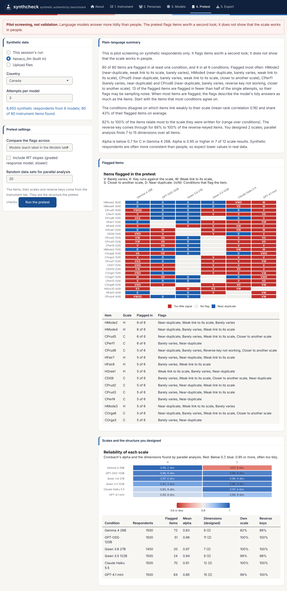
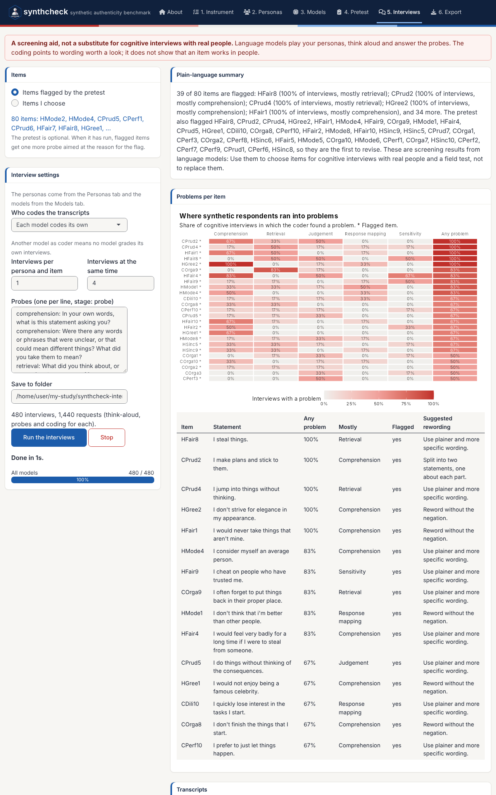

These demos walk through the app from start to finish.
The first three use real data to benchmark the models: Demos 1 and 2 need no
API key, so you can try them right away, and Demo 3 is a real run with your
own questionnaire. Demo 4 takes the path without real data: A pretest and
cognitive interviews, also without an API key. For what every control does,
see [the tour of the app](app-tour.html).

```r
library(synthcheck)
run_synthcheck_app()
```

The app opens on the **About** tab with one question: **Do you already have
real responses to this instrument?** Answer **Yes, I have real data** for
Demos 1 to 3, and **No, not yet** for Demo 4. Then click **Start with the
instrument** to go straight to the first step, or **Take the guided tour**
for a walkthrough of the path you chose (it needs the cicerone package).

## Demo 1: Benchmark the six built-in models

The package ships synthetic answers from six language models to the
IPIP-HEXACO items (`hexaco_llm`), so you can run the benchmark without
generating anything.

1. **About:** Answer **Yes, I have real data**.
2. **Instrument:** Keep **IPIP-HEXACO (built in)** and the traits
   Honesty-Humility and Conscientiousness (80 items).
3. **Compare:** Under *Real data*, choose **Built in, for the instrument in
   tab 1** (for HEXACO, that is `hexaco_real`) and *Canada*. Under *Synthetic data*, choose **hexaco_llm (built in)**,
   *Canada* and 3 attempts per model.
4. Switch off **Include person fit** for a faster first run, and click
   **Run the benchmark**.


The summary names each model's score and its weakest column, and the
behaviour features that differ most from real people. On these two traits
every model lands below 0 on at least one column: Its respondents are further
from real Canadians than shuffled real answers are. That is a strict
baseline, and the table still ranks the models and shows where each one
falls short. Switch person fit back on to add the person fit feature and the
"too coherent" line to the summary.

The same benchmark in code:

```r
items <- hexaco_items[hexaco_items$trait %in% c("H", "C"), ]
real <- hexaco_real[hexaco_real$country == "Canada", ]
ca <- hexaco_llm[hexaco_llm$country == "Canada" & hexaco_llm$attempt <= 3, ]
bm <- authenticity_benchmark(as_synthetic_list(ca), real, items, fit_scales = character(0))
summarise_benchmark(bm)
```

## Demo 2: A practice run with the mock provider

The mock provider answers at random, without an API, so a practice run costs
nothing and shows every step of a real one.

1. **About:** Answer **Yes, I have real data**.
2. **Instrument:** Keep IPIP-HEXACO and choose only Honesty-Humility (40
   items).
3. **Personas:** Choose **Build a grid** and keep the example:
   Three ages, two genders and two countries make 12 personas.
4. **Models:** Choose the provider **Mock (random answers, no API)** and click
   **Add model**. Change the label to *Mock B* and add it again, so there are
   two models to compare.
5. Set 2 attempts and 5 respondents per persona per attempt. The plan says
   240 synthetic respondents, 120 per model.
6. Click **Estimate run time**, then **Generate data**. The progress bar
   counts the respondents and shows the time left.


The persona check at the bottom finds no difference between the 12 personas,
as it should: The mock provider ignores personas.

7. **Compare:** Keep *This session's run* and the built-in real data,
   *Canada*, and run the benchmark.


Random answers land close to 0 on all three columns, which is what the
floor means: No better than shuffling the real answers within each item.
Overlap falls below 0 here because random answers on 40 items average out to
the middle of the scale, so the synthetic people bunch into a few middle
score deciles. The behaviour strip shows the other telltale sign of random
answers: More extreme answers and more variability than real people (blue).

8. **Export:** Download the results report (HTML or PDF), the data in the
   format you need, and the R script that repeats the comparison.

To try the same practice run on a short scale with known item problems,
choose the **Rosenberg Self-Esteem Scale**, the **DASS-21** or the
**Mini-IPIP** in step 2. The built-in real data in step 7 follow the
instrument.

## Demo 3: Your own questionnaire, with real models

For a real study, you bring three things: The items, the personas and real
answers to the same items.

1. **About:** Answer **Yes, I have real data**.
2. **Instrument:** Choose **Upload an item table**, click **Download a
   template**, and fill it in with your items. Use the same item names as the
   columns of your real data. Mark reverse-keyed items with `TRUE` in
   `reverse`, so that the benchmark can key them. Set the lowest and highest
   category and check the labels and instructions.
3. **Personas:** Upload a persona table (download the template on the same
   tab), or build a grid from the attributes that matter in your population,
   such as age, gender and region.
4. **Models:** Enter your API keys, or set `ANTHROPIC_API_KEY` and
   `OPENAI_API_KEY` in `.Renviron` before you start R. If you do not have a
   key yet, [Getting an API key](api-keys.html) shows how to get one. Add the models to
   compare, for example `claude-haiku-5-5` and `gpt-4.1-nano` at temperature
   1. For a local model, start Ollama, choose *Ollama (local)* and click
   **Refresh the model list**.
5. Start small: 1 attempt and 2 respondents per persona. Click **Estimate
   run time** to check the keys and see the time for a full run. The plan
   shows the estimated cost, and **Generate data** asks you to confirm it.
   Then raise the attempts (5 or more give a sense of stability) and
   generate again: The answers you already have come from the cache and cost
   nothing.
6. **Compare:** Upload your real data (CSV, Excel or RDS, one row per
   person, the items as columns) and run the benchmark.
7. **Export:** Save the results report, the data and the R script with
   your results.

The same run in code:

```r
ins <- sc_instrument(read.csv("my_items.csv"), scale = c(1, 5), name = "My survey")
per <- sc_personas(read.csv("my_personas.csv"))
syn <- generate_synthetic(ins, list(sc_model("anthropic"), sc_model("openai")), per,
                          attempts = 5, respondents = 10, parallel = 8, output = "my_run")
real <- read.csv("my_real_data.csv")
bm <- authenticity_benchmark(as_synthetic_list(syn), real, ins$items)
gg_benchmark(bm)
summarise_benchmark(bm)
```

## Demo 4: A new scale without real data

Before a scale has been fielded, there are no real answers to benchmark
against. The path without real data screens the items on synthetic
respondents instead and lets language models play your personas in
cognitive interviews. This demo uses the built-in `hexaco_llm` and the mock
provider, so it needs no API key.

1. **About:** Answer **No, not yet**. The fourth tab becomes **Pretest**,
   the fifth **Interviews** and the sixth **Export**. Compare is hidden.
2. **Instrument:** Keep IPIP-HEXACO and choose Honesty-Humility and
   Conscientiousness (80 items). The `scale` and `reverse` columns of the
   items are the structure the pretest checks.
3. **Personas:** Choose **Type them** and keep the three example personas.
4. **Pretest:** Under *Synthetic data*, choose **hexaco_llm (built in)**,
   *Canada* and 3 attempts per model. Keep *Compare the flags across:
   Models* and click **Run the pretest**.



The summary names the items that most models flag and the scales whose
structure does not come back as designed. The plot shows each flagged item
with the number of models that flag it: An item that every model flags is
worth reading again, one flagged by a single model less so. Language models
answer more tidily than people, so treat the flags as a reading list, not a
verdict.

5. **Models:** Add **Mock (random answers, no API)**. The interviews use the
   models of this tab and the personas of the Personas tab. With an API key,
   add a real model instead, for example `claude-haiku-5-5`.
6. **Interviews:** Keep **Items flagged by the pretest** and click **Run the
   interviews**. The plan counts the interviews and the requests.



The heatmap shows which kinds of problems each item ran into, and the
transcripts show what each persona said. Mock interviews are made-up text
that only show how the tab works. With a real model, read the transcripts of
the flagged items and the suggested rewordings, and decide which items to
reword before the field test.

7. **Export:** Download the results report with the pretest and the
   interviews, the transcripts and the R script that repeats them. Once real responses come in, go back to
   the About tab, answer **Yes, I have real data**, and benchmark the same
   synthetic data in the Compare tab.

The same steps in code:

```r
items <- hexaco_items[hexaco_items$trait %in% c("H", "C"), ]
ca <- hexaco_llm[hexaco_llm$country == "Canada" & hexaco_llm$attempt <= 3, ]
pt <- synthetic_pretest(as_synthetic_list(ca), items, irt = FALSE)
summarise_pretest(pt)
gg_pretest(pt)

iv <- cognitive_interview(sc_instrument(items, scale = c(1, 7)), sc_model("mock"),
                          sc_personas(c("You are a 34-year-old nurse living in Calgary, Canada.",
                                        "You are a 21-year-old university student in Toronto, Canada.")),
                          pretest = pt)
gg_interview(summarise_interviews(iv))
```

### Things to keep in mind

- **Cost.** The number of calls is models × attempts × personas ×
  respondents. Check the plan, the estimated cost and the time estimate
  before a large run, and set a spending limit with the provider
  ([Getting an API key](api-keys.html)). The same settings again come from
  the cache for free.
- **Independence.** Keep one respondent per call unless cost forces a
  larger batch. Respondents in the same call see each other's answers.
- **Keys.** Run the app on your own computer. Do not deploy it on a shared
  server with keys typed in, and keep keys out of scripts and Git.
- **What the benchmark says.** It tells you which model resembles your real
  respondents most, and on which side it falls short. It does not show that
  synthetic data can replace a field test.
- **What the pretest and the interviews say.** They point to items worth a
  second look before the field test. They do not show that a scale works in
  people, and they are not a substitute for cognitive interviews with real
  people.
